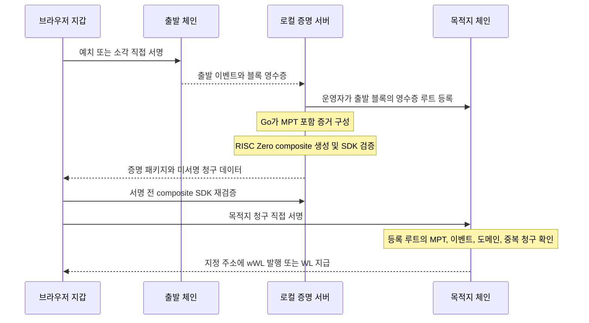

# BNC-WL · WorldLand ↔ BSC 공용 Vault 브리지

WorldLand의 네이티브 WL을 공용 Vault에 예치하면 BNB Smart Chain(BSC)에서 같은 수량의 ERC-20 wWL을 발행합니다. wWL은 일반 ERC-20처럼 보유자 간 전송과 사용 승인이 가능하고, 보유자가 wWL을 소각하면 Vault가 소각에 기록된 WorldLand 주소로 WL을 지급합니다. **상환 권리는 wWL을 따라 이동합니다.** 예치자, wWL 보유자, 청구 거래 서명자, 최종 수신자는 서로 달라도 됩니다.

현재 확인한 범위는 로컬 Anvil 체인 31337과 31338입니다. 두 방향의 사용자 브라우저 서명, 실제 RISC Zero composite 증명과 서버 SDK 검증, 제3자 상환, 미청구 상태의 재시작 복구를 완료했습니다. [Word 설계안](docs/wl-vault-bridge-brief-20261110.docx) · [종합 실행 결과](results/wl-vault-validation/summary.json)

## 목차

- [로컬에서 실행하기](#로컬에서-실행하기)
- [지갑에서 왕복해 보기](#지갑에서-왕복해-보기)
- [증명과 자산 이동](#증명과-자산-이동)
- [미완료 거래와 재시작](#미완료-거래와-재시작)
- [검증 결과](#검증-결과)
- [저장소 구조](#저장소-구조)
- [빌드와 회귀 검사](#빌드와-회귀-검사)

## 로컬에서 실행하기

저장소 루트에서 다음 명령을 실행한 뒤 [Vault 지갑](http://127.0.0.1:8584/)을 엽니다.

```bash
bash scripts/run-vault.sh
```

| 항목 | 기본값 |
| --- | --- |
| 지갑과 증명 API | `http://127.0.0.1:8584/` |
| WorldLand 역할 | Anvil 31337 · `http://127.0.0.1:8569` |
| BSC 역할 | Anvil 31338 · `http://127.0.0.1:8570` |
| 상태 디렉터리 | `results/wl-vault-v1` |
| 세션 프로필 | `native-wl-vault-v1` |
| 증명 생성기와 검증 호스트 | `.bin/bridge-vault-proof` · `.bin/bridge-vault-receipt-host` |
| 확인 깊이 | 출발 이벤트 블록 이후 2블록. 로컬 런처는 이벤트 확인 후 필요한 블록을 Anvil에서 생성합니다. |

Linux 또는 WSL 환경에서 Bash, Python 3, `flock`, Foundry의 `anvil`·`cast`, Vault 런타임 바이너리 두 개와 RISC Zero `r0vm`을 사용합니다. 새 상태 디렉터리에 계약을 배포할 때는 `forge`와 Solidity 0.8.24도 필요합니다. 일반 지갑 사용은 브라우저에서 가능하고, 자동화된 실브라우저 검사는 Node.js와 Playwright, Chromium을 사용합니다. [실행기](scripts/run-vault.sh) · [런타임 경로 확인](scripts/runtime-config.py) · [브라우저 검사 환경](scripts/browser-runtime.mjs)

HTTP 포트만 바꾸려면 `BNC_API_PORT`를 지정합니다. RPC 포트는 새 상태를 만들 때 `BNC_WL_PORT`, `BNC_BNB_PORT`로 설정하며, 생성된 세션은 저장된 RPC 주소를 다시 사용합니다. 검증에 사용한 상태와 분리해 실습하려면 다른 상태 경로와 비어 있는 포트 세 개를 사용합니다. [세션 설정과 소유권 검사](scripts/local-session.py)

```bash
BNC_STATE_DIR="$PWD/results/wl-vault-practice" \
BNC_API_PORT=8590 BNC_WL_PORT=8591 BNC_BNB_PORT=8592 \
  bash scripts/run-vault.sh
```

저장된 세션을 읽기만 하려면 다음 명령을 사용합니다. 같은 상태로 재시작할 때는 Vault 런처를 정상 종료한 후 동일한 경로로 다시 실행합니다. 런처는 종료 시 자신이 관리하는 두 Anvil 노드를 정리하고 상태 파일을 유지합니다. [세션 명령](scripts/local-session.py)

```bash
python3 scripts/local-session.py --vault --dir results/wl-vault-v1 status
```

## 지갑에서 왕복해 보기

지갑 첫 화면에는 세 작업이 분리되어 있습니다. 각 방향 페이지에서 지갑 연결, 출발 거래, 증명, 목적지 청구 순서로 진행하며, 확인된 단계에는 녹색 완료 표시가 붙습니다. 데모 지갑은 공개 Anvil 테스트 계정 A·B·C를 사용합니다. 확장 지갑 경로도 제공하며 아래 실행 결과는 Chromium의 데모 지갑을 기준으로 합니다. [Vault 첫 화면](wallet/vault.html) · [공통 단계 UI](wallet/burn-mint-page.mjs)

| 페이지 | 기능 | 출발 체인 거래 | 목적지 체인 거래 |
| --- | --- | --- | --- |
| [WL → wWL](wallet/vault-deposit.html) | WL 예치와 wWL 발행 | Vault의 `lock(recipient)`에 WL 첨부 | 지정 주소로 wWL을 발행하는 `submitLockProof` |
| [wWL → WL](wallet/vault-release.html) | wWL 소각과 WL 지급 | wWL의 `bridgeBurn(amount, recipient, 31337)` | 지정 주소에 WL을 지급하는 `submitBurnProof` |
| [WL · wWL 전송](wallet/vault-tools.html) | 체인별 일반 전송 | WorldLand의 네이티브 WL 전송 또는 BSC의 wWL 전송·사용 승인·승인받은 대리 전송 | 같은 체인에서 완료 |

### 10 WL 실습

1. **예치.** C 데모 지갑의 주소를 확인한 뒤 A로 연결합니다. **WL → wWL**에서 수량 10과 C의 BSC 주소를 입력하고 예치 거래를 검토·서명합니다. Vault로 10 WL이 이동하면 예치 기록에 10 WL과 아직 발행되지 않은 0 wWL이 표시됩니다.
2. **발행.** 해당 예치 기록에서 증명을 요청합니다. 증명이 준비되면 발행 청구를 검토·서명합니다. A가 청구를 서명해도 wWL 10개는 예치 이벤트에 적힌 C에게 발행됩니다.
3. **전송.** **WL · wWL 전송**에서 C로 연결해 B에게 10 wWL을 보냅니다. 전송 뒤에는 B가 그 수량을 소각할 수 있습니다.
4. **소각.** B로 연결해 **wWL → WL**에서 10 wWL을 소각하고 C의 WorldLand 주소를 지정합니다. 이때 소각 기록은 10 wWL, 지급량은 0 WL입니다.
5. **지급과 재전송.** 소각 증명을 준비한 뒤 지급 청구를 서명합니다. Vault가 C에게 10 WL을 보내면 C는 받은 WL을 WorldLand에서 다시 전송할 수 있습니다. [검증에 사용한 브라우저 절차](scripts/check-vault-browser.mjs)

브리지는 18자리 기본 단위에서 1:1로 처리합니다. 시장 거래 가격과 양쪽 체인의 가스비는 별도입니다. 지갑의 전송 메뉴는 실제 전송과 토큰 사용 승인을 제공하며, 로컬 시연에서는 시장 거래에서 일어나는 소유권 이전을 두 테스트 지갑 사이의 전송으로 재현했습니다. [거래별 브라우저 영수증](results/wl-vault-validation/browser-summary.json)

## 증명과 자산 이동



1. **출발 이벤트.** WorldLand에서는 네이티브 WL이 실제로 Vault에 들어올 때 `VaultLocked`가 기록됩니다. BSC에서는 보유자의 wWL이 실제로 소각될 때 `VaultBurned`가 기록됩니다. 각 ID는 체인·계약 주소, 송신자·수신자, 수량과 nonce에 묶입니다.
2. **영수증 포함과 연산 증명.** Go 생성기는 출발 블록의 영수증을 모아 MPT를 재구성합니다. RISC Zero guest는 주어진 루트의 MPT 경로와 영수증·이벤트를 계산하고, 호스트는 실제 composite와 고정 Image ID를 SDK로 검증합니다.
3. **목적지 청구.** 브라우저는 패키지와 청구 데이터를 검토하고 SDK 재검증을 거쳐 사용자 서명을 요청합니다. 목적지 계약은 운영자 등록 루트를 기준으로 MPT·이벤트·체인과 자산 도메인·수량·수신자·중복 여부를 확인합니다. 지급에 실패하면 목적지의 청구 처리와 지급 누계를 함께 되돌립니다. [계약·증명 구현 상세](docs/implementation-details.md)

이 모델은 **서버 운영자와 출발 RPC를 신뢰**합니다. RISC Zero 검증은 서버 SDK에서 수행하고, EVM의 청구 조건은 등록 루트 기반 영수증 검증입니다. 원본 체인의 합의나 최종성은 독립적으로 인증하지 않습니다. 실제 WorldLand·BSC의 RPC 및 영수증 호환성, 확인 깊이, 루트 운영과 비상 대응, 실자산 배포와 검증은 별도 범위입니다. [신뢰 경계와 운영 범위](docs/implementation-details.md#10-신뢰-경계와-실운영-범위)

## 미완료 거래와 재시작

- **출발 거래가 이미 성공한 경우.** 같은 방향에서 **내 예치 기록** 또는 **내 소각 기록**을 열고 해당 건을 선택합니다. 기록은 연결한 주소가 송신자이거나 수신자로 지정된 출발 이벤트를 보여 줍니다. 예치·소각 ID와 출발 블록을 직접 입력하거나 이전에 받은 증명 JSON을 다시 검증할 수도 있습니다.
- **증명 생성 중인 경우.** 진행 상태를 확인합니다. 새 탭이나 다른 브라우저에서 같은 이벤트를 불러와도 서버가 동일 작업 ID를 사용합니다. 실패한 작업은 원인을 확인한 뒤 같은 예치·소각에서 다시 요청합니다.
- **거래를 지갑에서 보낸 뒤 응답을 받지 못한 경우.** 미확인 거래 상태 조회를 사용합니다. 브라우저가 해시를 받지 못한 경우에는 지갑 거래 내역과 출발 체인의 기록을 먼저 확인합니다. UI가 자산 거래를 자동 재전송하지 않습니다.
- **런처를 재시작하는 경우.** 같은 `BNC_STATE_DIR`에서 실행하면 두 체인의 계약·잔액, proof job, 캐시와 브라우저 세션 키가 유지됩니다. 저장된 증명은 다시 SDK 검증을 거쳐 사용합니다. 재시작 검증에서는 지급 전 두 노드와 API를 종료한 뒤 같은 소각 ID로 지급했고, 새 증명 생성은 0건이었습니다. [중단 지점과 복구 절차](docs/wl-vault-development-checklist.md) · [재시작 비교 결과](results/wl-vault-validation/restart-result.json)

| 증상 | 확인할 곳 |
| --- | --- |
| `Vault launcher already active` | 해당 상태 디렉터리를 사용하는 런처와 `launcher.lock` |
| 시작 시 포트 점유·RPC 소유권 오류 | HTTP/RPC 포트, 저장한 `session.json`의 RPC와 노드 PID |
| 발행·지급 버튼 비활성 | 선택한 기록, 실제 SDK 검증 완료 여부, 연결한 지갑·목적지 체인, 미확인 거래 또는 이미 처리된 ID |
| 장시간 증명 대기 또는 실패 | `proof-jobs/<job-id>.json`과 해당 캐시 디렉터리의 `sdk.log`, `run.log`, `run-result.json` |
| 런타임 누락 또는 Image ID 불일치 | Vault용 바이너리 경로와 고정 정책. |

## 검증 결과

2026-11-10에 저장한 격리 로컬 실행 결과입니다. 수치는 실행 근거에 기록된 값을 사용했습니다. [종합 실행 결과](results/wl-vault-validation/summary.json)

| 확인 항목 | 결과 |
| --- | --- |
| 브라우저 서명 6건 | A의 10 WL 예치 → C에게 10 wWL 발행 → C가 B에게 10 wWL 전송 → B의 소각 → C에게 10 WL 지급 → C의 2 WL 재전송 |
| 공용 담보와 발행 잔량 | 누적 예치 10 WL · 누적 지급 10 WL · 최종 Vault 0 WL · 최종 wWL 공급 0 |
| 예치 composite | 248.63초 · 537,340바이트 · 실제 SDK 검증 성공 |
| 소각 composite | 258.70초 · 537,340바이트 · 실제 SDK 검증 성공 |
| 실패 경로 | 체인·수신자·수량·composite 변조, 양방향 중복 청구, 담보 부족, 지급 실패 시 롤백을 검사 |
| 재시작 | 두 노드 PID 변경 · 블록과 루트·잔액·증명 지문 유지 · 복구 요청 2건 기존 작업 ID로 병합 |
| 회귀와 기존 증거 | Solidity 52개, Node 지갑 16개, Go·Rust·기존 SDK 회귀 통과 · 보존한 상태 파일 63개 SHA256 일치 |

개별 브라우저 영수증은 [예치](results/wl-vault-validation/deposit-receipt.json), [발행](results/wl-vault-validation/mint-receipt.json), [wWL 전송](results/wl-vault-validation/transferWrapped-receipt.json), [소각](results/wl-vault-validation/burn-receipt.json), [WL 지급](results/wl-vault-validation/release-receipt.json), [WL 재전송](results/wl-vault-validation/transferNative-receipt.json)에서 확인할 수 있습니다.

## 저장소 구조

| 구성 | 역할 |
| --- | --- |
| [contracts/src/bridge/NativeWLVault.sol](contracts/src/bridge/NativeWLVault.sol) | 네이티브 WL 보관, 예치 이벤트, 소각 증명 기반 지급과 지급 회계 |
| [contracts/src/token/VaultWrappedWL.sol](contracts/src/token/VaultWrappedWL.sol) | 18자리 ERC-20 wWL, 잠금 증명 기반 발행, 보유자 소각 |
| [contracts/src/bridge/VaultReceipt.sol](contracts/src/bridge/VaultReceipt.sol) | 양쪽 청구의 공통 영수증·도메인 검증과 이동 ID |
| [proof-generator/](proof-generator/) | 출발 RPC 조회, 영수증 인코딩·MPT, 이벤트 검사, 청구 calldata 생성 |
| [risc0/receipt-computation/](risc0/receipt-computation/) | Rust guest와 호스트, journal 계산, composite 생성·검증 |
| [scripts/proof-service.py](scripts/proof-service.py) · [scripts/receipt-computation.py](scripts/receipt-computation.py) | 루트 등록·API·작업 큐, 고정 정책, 증명 캐시와 재검증 |
| [wallet/](wallet/) | 지갑 페이지, 수신자·패키지 검토, 브라우저 직접 서명, 상태 및 기록 |
| [results/wl-vault-v1/](results/wl-vault-v1/) · [results/wl-vault-validation/](results/wl-vault-validation/) | 세션·노드·증명 캐시와 별도 인수 검증 근거 |

## 빌드와 회귀 검사

Vault 런타임 바이너리가 필요한 경우 저장소 루트에서 다음과 같이 빌드합니다. Rust 빌드 결과의 guest Image ID를 `configs/vault-computation.json`과 대조한 뒤 해당 호스트를 `.bin/bridge-vault-receipt-host`로 설치합니다. 증명으로 새 빌드를 확인하려면 기존 receipt의 복사본을 호스트의 `verify` 모드로 검증할 수 있습니다. [Vault 빌드·검증 상세](docs/implementation-details.md#11-빌드와-검증-재현)

저장된 로컬 Vault 증명은 기존 고정 호스트를 사용합니다. 테스트넷 지원을 추가한 소스에서 새로 빌드한 로컬 guest의 Image ID가 기존 정책과 다르면, 저장된 세션에는 함께 제공된 고정 호스트를 사용합니다.

```bash
mkdir -p .bin
go -C proof-generator build -buildvcs=false -o ../.bin/bridge-vault-proof ./cmd/bridge-proof
cargo build --release --locked --manifest-path risc0/receipt-computation/Cargo.toml \
  -p bridge-receipt-host --features vault
```

```bash
forge test --root contracts
go -C proof-generator test ./...
cargo test --locked --manifest-path risc0/receipt-computation/Cargo.toml \
  -p bridge-receipt-core --features vault
node --test wallet/client.test.mjs wallet/burn-mint.test.mjs
python3 scripts/check-runtime-resources.py
```

인수 검사 순서는 체크리스트에 있습니다. 브라우저 검사와 재시작 비교 도구는 기본 검증 세션, 저장된 거래 및 증명 ID를 사용합니다. 브라우저 검사에서 수동 실습을 섞으면 검증용 잔액과 거래 nonce가 바뀔 수 있으므로 수동 실습은 별도 상태에서 진행할 수 있습니다. [개발 체크리스트와 재개 절차](docs/wl-vault-development-checklist.md)

## 참고 자료

- Gwangju·BSC 테스트넷 배포 전 입력, 미서명 배포 계획, 읽기 전용 증명 서버. [테스트넷 준비 절차](docs/vault-testnet-preflight.md)
- 계약·API·증명 형식, 신뢰 경계와 상태 복구. [구현 상세](docs/implementation-details.md)
- 연구·발표용 자산 흐름과 10 WL 예시. [Word 설계안](docs/wl-vault-bridge-brief-20261110.docx)
- 실제 검증 수치와 운영 확인 사항. [현재 개발 상태](docs/current-status-report.md#공용-vault-로컬-구현검증-완료--2026-11-10) · [실행 증거](results/wl-vault-validation/summary.json)

발표 자료를 만들 때는 A의 WL 예치와 wWL을 받은 뒤의 제3자 상환을 두 체인으로 나눠 표시합니다. SDK의 RISC Zero 검증과 목적지 계약의 MPT 검증을 각각 표기하고, 로컬에서 실행한 결과와 실제 체인의 운영 확인 사항을 분리합니다.
