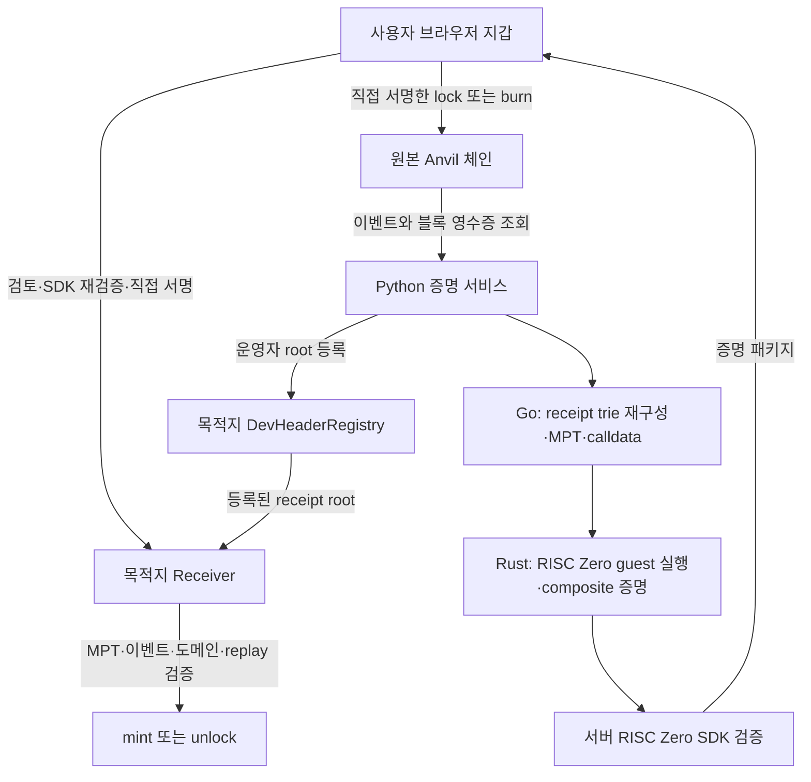

# BNC-WL 코드 현황 및 작동 방식 보고서

기준일: **2026년 11월 3일, 한국 시간**  
대상: `/home/gangryun/BNC-WL`의 현재 활성 소스와 보존된 로컬 세션  
검토 방법: 소스 분석, 기준 SHA256 대조, 기존 증명 SDK 재검증, 회귀 검사 일부 실행, 로컬 포트 읽기 전용 조회

## 1. 현재 상태와 핵심 결론

BNC-WL은 **서버 운영자와 RPC를 신뢰하는 로컬 양방향 브리지 시제품**이다. 사용자는 웹 지갑에서 원본 토큰 잠금, wrapped 토큰 발행 청구, wrapped 토큰 소각, 원본 잠금 해제 청구를 직접 승인하고 서명한다. 서버는 이벤트를 수집하고 MPT 패키지와 실제 RISC Zero 연산 증명을 만들며, 운영자 권한으로 목적지 체인에 원본 블록의 receipt root를 등록한다.

현재 코드는 실제 WorldLand·BNB 체인에 배포한 서비스가 아니다. 두 Anvil 체인 **31337 / 31338**을 사용하며, 복구된 기본 실행 모드는 **`risc0-computation` 하나**다. 원본 합의·최종성 인증과 RISC Zero 증명 자체의 온체인 검증은 구현 범위에 포함되지 않는다.

| 항목 | 2026-11-03 확인 결과 |
| --- | --- |
| 코드 기준본 | 10월 29일 정리 후 SHA256 목록의 94개 파일 모두 일치 |
| 현재 서비스 | 기본 UI 8580, RPC 8565·8566 모두 연결 거부. 확인 시점에 기본 주소에서 서비스 미실행 |
| 실행 준비 | `server-doctor.py` 7개 항목 통과. 필수 도구·바이너리·고정 guest 증명 확인 |
| 기존 실제 증명 | 현재 세션의 lock·burn composite receipt 2개 SDK 재검증 통과 |
| 변조·취소 회귀 검사 | 실제 SDK 및 프로세스 취소 검사 7개 통과 |
| 감사 기록 | 감사 회귀 검사 통과, 현재 JSONL 11개 항목의 해시 연결 정상 |
| 마지막 전체 실행 증거 | 10월 29일 브라우저 직접 서명 거래 4개와 양방향 새 증명 2개 성공 |
| 이번 보고서 작업의 실행 범위 | 새 증명 0개, 사용자·운영자 거래 0개, 체인 시작·계약 배포 0개 |

**‘구현과 기존 실행 증거가 검증되어 있다’와 ‘현재 서버가 켜져 있다’는 구분해야 한다.** 현재는 전자에 해당한다. 저장된 `session.json`의 `phase: ready`와 job의 `state: ready`는 저장 상태이며 프로세스 생존을 뜻하지 않는다. 이번에는 서버를 기동하지 않아 현재 체인 잔액과 UI를 실시간으로 다시 확인하지 않았다.

## 2. 전체 구조



연산 증명은 **서버 SDK에서 검증된 뒤 브라우저에 전달**된다. 목적지 Receiver의 입력에는 블록 식별자·거래/로그 위치·MPT 노드가 들어가며, RISC Zero composite receipt 자체는 들어가지 않는다. 따라서 웹앱이 증명을 필수로 요구하는 것과 계약이 연산 증명을 직접 강제하는 것은 서로 다른 검증 경계다.

| 계층 | 구현 기술 | 주요 역할 |
| --- | --- | --- |
| 브라우저 | HTML/CSS, JavaScript ES modules, ethers 6.15.0 | 지갑 연결, 패키지 검증, 미리보기, 사용자 서명, 거래 상태 복구 |
| 서비스 | Python 표준 라이브러리 HTTP 서버 | job 관리, root 등록, 증명 실행, SDK 검증 API, 감사 기록 |
| MPT 생성기 | Go, go-ethereum 1.14.12 | 전체 블록 영수증의 trie 재구성, 이벤트 검증, 청구 calldata 생성 |
| 연산 증명 | Rust, RISC Zero SDK 3.0.5 | 고정 guest 계산 증명, composite receipt 생성·검증 |
| 목적지 계약 | Solidity 0.8.24 | 등록 root 기반 MPT·이벤트·도메인·중복 검증, mint/unlock |
| 실행 환경 | Anvil 2개, Foundry, r0vm | 로컬 체인, 배포·운영자 거래, CPU proving |

## 3. 코드 구성과 읽는 순서

| 경로 | 현재 책임 | 직접 작성한 코드 집계 |
| --- | --- | --- |
| `wallet/` | 화면, 지갑 클라이언트, 데모 서명기, 단위 검사 | 7개 / 771줄 |
| `scripts/` | 실행·세션·서비스·증명·감사·검사·패키징 | 18개 / 1,629줄 |
| `proof-generator/` | RPC 어댑터, receipt codec, MPT, ABI, fixture 도구·검사 | 17개 / 1,747줄 |
| `risc0/` | core, host, guest 및 methods 연결 | 5개 / 109줄 |
| `contracts/` | 토큰, registry, receiver, MPT/RLP 라이브러리·검사 | 21개 / 1,796줄 |
| 합계 | 위 다섯 경로 | 68개 / 6,052줄 |

집계는 `.py/.mjs/.go/.rs/.sol/.sh/.html/.css`의 물리적 줄 수다. 주석과 테스트는 포함하고 vendor·생성 캐시·JSON fixture·TOML·lockfile·문서는 제외했다. 여러 문장을 한 줄에 쓴 코드가 있으므로 줄 수를 기능 규모나 품질로 해석하면 안 된다. SHA256 비교의 94개는 설정·fixture 등을 포함한 별도의 기준 목록이다.

처음 읽을 때는 다음 순서가 전체 흐름을 파악하기 좋다.

1. `scripts/run-server.sh` → `run-prototype.sh`: 기동과 사전 검사.
2. `scripts/local-session.py`: 체인 신원 확인, 기존 상태 재개, 배포와 역할 연결.
3. `wallet/ui.mjs` → `wallet/client.mjs`: 사용자 동작과 서명 전 검증.
4. `scripts/proof-service.py`: 증명 요청·상태 전이·패키지 제공.
5. `proof-generator/internal/receipt/proof.go`: receipt trie와 MPT 생성.
6. `risc0/receipt-computation/core/src/lib.rs` → `host/src/main.rs`: 증명할 계산과 SDK 검증.
7. `contracts/src/bridge/LockMintReceiver.sol` / `BurnUnlockReceiver.sol`: 최종 지급 조건.

지갑은 프레임워크 빌드 없이 정적 파일로 제공한다. 앱 실행에 Node.js·Playwright가 필수인 구조는 아니며, 이들은 지갑 단위 검사와 실제 브라우저 검사에 사용된다. 지속 실행에 필요한 프로젝트 바이너리는 `.bin/bridge-proof`, `.bin/bridge-receipt-host`이고 r0vm은 별도로 필요하다.

## 4. 자산은 어떻게 움직이는가

### 4.1 원본 토큰은 계정 내부에서 사용 가능 수량을 잠근다

`BridgeLockableToken.bridgeLock()`은 원본 토큰을 별도 보관 주소로 전송하지 않는다. 사용자 `balanceOf`를 유지하면서 `_lockedBalance`를 늘린다. 사용 가능한 양은 `balanceOf − lockedBalance`이며, 전송할 때도 이 한도를 적용한다. `bridgeUnlock()`은 잠금 수량을 줄여 사용 가능 잔액을 복원한다.

wrapped 측은 `BridgeWrappedToken`을 새로 발행·소각한다. 현재 wrapped 토큰의 일반 전송과 승인은 금지되어 있고, lock·burn 모두 송신자와 수신자가 같아야 한다. 따라서 **동일 소유자가 두 체인 사이를 왕복하는 모델**이며, 타인에게 보내는 일반 자산 브리지나 자유롭게 거래되는 wrapped 자산 모델은 아니다.

아래는 원본 100개 중 1개를 왕복하는 설명용 예시다. 실제 10월 29일 보존 증명의 금액도 양방향 각각 `10^18` 기본 단위, 즉 18자리 소수 기준 1개다.

| 단계 | 원본 총잔액 | 원본 잠금 | 원본 사용 가능 | wrapped 잔액 |
| --- | --- | --- | --- | --- |
| 시작 | 100 | 0 | 100 | 0 |
| lock 수락 | 100 | 1 | 99 | 0 |
| mint 청구 수락 | 100 | 1 | 99 | 1 |
| burn 수락 | 100 | 1 | 99 | 0 |
| unlock 청구 수락 | 100 | 0 | 100 | 0 |

원본 총잔액에는 잠금분이 포함된다. 원본 총잔액과 wrapped 잔액을 단순히 더하면 같은 권리를 중복 계산하게 된다. 또한 source 거래와 destination 청구 사이에 대기 구간이 있으므로, 중간 단계에서는 잠금량과 wrapped 발행량이 항상 같지는 않다.

### 4.2 계약별 책임

| 계약 | 책임과 주요 제한 |
| --- | --- |
| `MinimalERC20` | 잔액·공급량·기본 전송/승인, 토큰별 전송 훅 |
| `BridgeLockableToken` | 잠금·사용 가능 잔액, lock nonce, unlock 재사용 방지, receiver·목적지 토큰 1회 연결 |
| `BridgeWrappedToken` | 지정 receiver만 mint, 소유자 burn, burn nonce, 일반 전송·approve 금지 |
| `DevHeaderRegistry` | 지정 운영자만 root 등록, 동일 높이의 상충 등록 거부, 31337↔31338 조합 제한 |
| `LockMintReceiver` | Locked 이벤트 증명 확인 후 원래 수신자에게 mint |
| `BurnUnlockReceiver` | Burned 이벤트 증명 확인 후 원래 소유자의 잠금 해제 |
| `MPTReceiptProofCore` 및 라이브러리 | RLP·MPT·영수증 성공 상태·로그 구조 검증 |
| `BridgeAuditLog` | 감사 digest 기록과 사고 시 정지 상태 |
| `DevMock*Receiver` | 로컬 계약 테스트용 mock. 기본 배포는 실제 MPT Receiver 사용 |

브라우저는 소유자 계정의 청구 서명을 요구한다. Receiver 자체는 청구 호출자의 주소보다 **증명된 이벤트의 수신자와 중복 여부**를 검사한다. 다른 주소가 같은 유효 청구를 먼저 제출하더라도 지급 대상은 이벤트의 소유자로 고정된다.

## 5. 한 번의 전송이 처리되는 순서

### 5.1 WorldLand 역할 체인 → BNB 역할 체인

1. **거래 준비:** 브라우저가 연결 계정·체인 ID·배포 코드·사용 가능 토큰·가스 잔액을 확인한다. `eth_call`과 가스 추정으로 실행 가능성을 확인한다.
2. **원본 잠금:** 사용자가 `bridgeLock(amount, owner, 31338)`를 승인하고 브라우저 지갑이 서명한다. 계약은 잠금 수량과 nonce를 갱신하고 `Locked` 이벤트를 기록한다.
3. **증명 요청:** UI가 `action`, `transferId`, `fromBlock`을 서버로 보낸다. 서버는 동일 요청을 같은 job ID로 합친다.
4. **확인 블록·root 등록:** 서버는 유일한 해당 이벤트와 기본 2블록 대기를 확인한다. 로컬 데모에서는 실제 이벤트를 찾은 뒤 필요한 블록을 채굴할 수 있다. 운영자가 목적지 registry에 block hash와 receipts root를 등록한다.
5. **MPT 생성:** Go가 원본 블록의 거래 목록과 전체 영수증을 가져와 trie를 재구성한다. RPC의 `receiptsRoot`와 계산값을 비교하고, 해당 영수증·이벤트를 입증하는 노드를 추출한다.
6. **실제 연산 증명:** Python이 고정 guest 입력을 구성하고 Rust host가 RISC Zero composite receipt를 만든다. SDK 검증과 guest journal 일치 확인을 통과해야 패키지가 준비된다.
7. **원본 재확인:** 증명 생성 후 block hash·root·확인 블록 수·목적지 등록 root를 다시 검사한다. 중간에 source 상태가 바뀌면 반환을 거부한다.
8. **청구 검토:** 브라우저가 MPT·이벤트·수량·수신자·도메인·calldata를 다시 계산하고, receipt SHA256·journal/input 연결과 서버 SDK 재검증 결과를 확인한다.
9. **목적지 사용자 서명:** 검토와 실제 서명 직전에 root·replay·코드·가스·계정·SDK 결과를 재확인한다. 사용자가 `submitLockProof`를 서명한다.
10. **발행:** 목적지 계약은 등록 root에 대한 MPT와 이벤트 도메인을 검사하고, 사용한 transfer ID를 기록한 뒤 wrapped 토큰을 발행한다.

### 5.2 반환: burn → unlock

반환은 같은 구조다. 사용자가 BNB 역할 체인의 `bridgeBurn(amount, owner, 31337)`을 승인하면 wrapped 수량이 감소한다. 서버가 `Burned` 이벤트의 MPT와 RISC Zero 증명을 준비하고, 사용자가 WorldLand 역할 체인의 `submitBurnProof`를 승인하면 원본 사용 가능 수량이 복원된다.

사용자 자산 거래는 왕복 기준 **lock·mint 청구·burn·unlock 청구의 4개**다. 운영자 root 등록과 감사 commitment는 별도 운영자 거래다. 서버에 사용자 자산 거래를 대신 서명하는 CLI는 현재 지원 경로에 없다.

## 6. 세 종류의 증거와 RISC Zero의 정확한 역할

이 프로젝트에서 ‘receipt’는 서로 다른 대상을 가리킬 수 있다.

| 이름 | 의미 | 검증 위치 |
| --- | --- | --- |
| EVM transaction receipt | 거래 성공 상태와 로그를 담은 체인 영수증 | Go·guest·브라우저·목적지 계약 |
| receipt MPT proof | 해당 영수증이 특정 `receiptsRoot`에 포함됨을 보여주는 노드 | Go·guest·브라우저·목적지 계약 |
| RISC Zero composite receipt | 고정 guest가 입력 계산을 올바르게 수행했다는 증명 | 서버의 실제 RISC Zero SDK |

### 6.1 guest가 검증하는 계산

guest 입력에는 동작, 양쪽 chain ID, 토큰 주소, 송신자·수신자, 수량·nonce·transfer ID, block number/hash, receipt root, transaction/log index, receipt bytes, MPT nodes 등 **17개 필드**가 들어간다. guest는 다음을 확인한다.

- MPT 경로와 노드 참조가 입력 root에 연결되고 최종 값이 입력 receipt bytes와 일치하는가.
- 영수증이 성공 상태이고, 지원하는 영수증 형식과 로그 구조를 따르는가.
- 로그 발행 토큰, Locked/Burned 서명, 소유자, 양수 수량, nonce, 목적지 chain ID가 맞는가.
- 소스·목적지 토큰과 체인을 포함한 도메인 계산이 transfer ID와 일치하는가.
- 송신자와 수신자가 같은 0이 아닌 주소인가.

결과 journal에는 검증 결과 필드와 전체 입력의 Keccak-256 commitment가 기록된다. block hash·number도 입력 commitment에 결합되지만, guest가 블록 헤더 해시나 합의를 계산하여 해당 블록의 진실성을 증명하는 구조는 아니다.

### 6.2 증명 정책과 재검증

| 항목 | 현재 값 또는 동작 |
| --- | --- |
| 정책 파일 | `configs/receipt-computation.json` |
| 고정 Image ID | `1d2847d6a7fa72e1a9b5d20444ec043818da086c2ed952493243499702021d21` |
| statement | `trusted-input-receipt-computation` |
| 전송 형식 | `risc0-sdk-bincode-3.0.5` |
| SDK 증명 형태 | `InnerReceipt::Composite`만 허용 |
| 입력 연결 | 실제 receipt journal과 core의 예상 journal 비교 |
| 파일 연결 | receipt bytes의 SHA256, Base64 전송, 입력 전체 기반 캐시 |
| 실패 처리 | 누락·변조·다른 guest·다른 입력·다른 scope면 거부 |

SHA256은 파일 전달 중 바뀌었는지 확인하는 해시다. **변조한 receipt의 SHA256을 새로 계산해도 실제 SDK 검증을 통과해야 하므로 해시만 맞춘 파일은 수용되지 않는다.** 이 경우의 거부 회귀 검사를 오늘 다시 실행했다.

저장 세션과 manifest에 보이는 `mode: dev`는 로컬 운영자 root registry 구성을 나타내는 내부 이름이다. 가짜 증명을 허용하는 `RISC0_DEV_MODE`와 다르다. 기본 실행기는 `risc0-computation`만 받고, 증명 프로세스에서 `RISC0_DEV_MODE`와 외부 proving credential을 제거한다. host에도 dev mode 거부가 있다. 저수준 도구의 `execute` 진단 기능은 SDK 증명 성공으로 인정되지 않는다.

## 7. 누가 무엇을 보장하는가

| 확인 대상 | 현재 담당 | 보장 경계 |
| --- | --- | --- |
| 사용자의 거래 승인 | 브라우저 지갑 | 공개 Anvil 데모 계정으로 실제 로컬 서명 확인. 외부 확장 지갑 실측은 미완료 |
| RPC 데이터의 정합성 | 서버·Go, 반복 RPC 조회 | 조회 간 불일치와 root 재구성 불일치 탐지. RPC 자체의 진실성은 신뢰 |
| 목적지 root의 권한 | `DevHeaderRegistry` | 지정 운영자가 등록했다는 사실. 원본 합의의 독립 검증은 없음 |
| receipt 포함·이벤트 계산 | MPT 검증과 RISC Zero guest | 주어진 root/입력에 대한 계산 정확성 |
| 실제 RISC Zero 증명 유효성 | 서버 SDK | 브라우저는 서버의 재검증 응답을 신뢰. 브라우저 자체 SDK 검증 없음 |
| 지급 대상·수량·목적지 | 브라우저·guest·Receiver | 이벤트와 도메인에 결합된 값만 사용 |
| 중복 지급 | Receiver mappings, 원본 unlock 기록 | 같은 ID의 mint/unlock 재사용 거부 |
| 원본 합의·경제적 최종성 | 현재 독립 인증 없음 | 로컬 2블록 대기를 실제 체인 최종성으로 해석할 수 없음 |

현재 정상 웹앱 경로는 RISC Zero 증명을 필수로 요구한다. 다만 Receiver ABI는 RISC Zero receipt를 받지 않으므로, **계약만 직접 호출하는 경로에서 SDK 검증 여부를 계약이 확인하지는 못한다.** 계약이 강제하는 것은 운영자 root를 기준으로 한 MPT·이벤트·도메인·replay 조건이다. 이는 현재 신뢰 모델의 명시적인 범위다.

감사 해시도 최초 입력의 진실성을 증명하는 수단은 아니다. 이후의 기록 변경을 탐지하고 운영 이력을 확인하는 역할이다. 현재 보고서는 기능·구현 상태 분석이며 전체 보안 감사나 실자산 운용 인증에 해당하지 않는다.

## 8. API와 데이터 구조

| 경로 | 역할 | 주요 조건 |
| --- | --- | --- |
| `GET /api/manifest` | 체인·계약 코드·세션·증명 정책 | 로컬 chain ID, 고정 guest와 검증 위치 명시 |
| `POST /api/jobs` | 증명 요청 생성/재확인 | 정확히 action·transferId·fromBlock 세 필드, 최대 4 KiB |
| `GET /api/jobs/{id}` | 작업 상태 | queued / running / waiting_confirmations / ready / failed |
| `GET /api/jobs/{id}/package` | 준비된 패키지 제공 | ready 상태, 현재 source/root 확인, 실제 SDK 재검증 |
| `POST /api/computation/verify` | 업로드 패키지 SDK 재검증 | 최대 16 MiB JSON, receipt 최대 8 MiB |
| `GET /api/chains` | 체인 연결·높이·최근 블록 | UI의 상태 갱신에 사용 |
| `GET /api/audit` | 감사 기록·anchor·정지 상태 | 기록 페이지네이션, 온체인 정지 지원 여부 구분 |
| `GET /api/transactions` | 계약 이벤트 조회 | 체인별 최대 2,000블록 단위 |
| `GET /api/health` | worker 생존 확인 | 전체 RPC·prover 건전성을 모두 입증하는 검사는 아님 |
| `POST /rpc/wl`, `/rpc/bnb` | 제한된 RPC 전달 | allowlist 읽기와 이미 서명된 raw transaction 전달 |

서비스에는 Host/Origin 검사, 변경 요청의 `X-Bridge-Request: 1`, CSP, 본문 크기 제한과 동시 HTTP 요청 슬롯 32개가 있다. 브라우저 RPC 전달 경로에는 서버 서명·unlocked send·관리자 RPC가 노출되지 않는다. 기본 데모 지갑은 loopback RPC를 직접 사용하며, public origin 구성에서는 제한된 `/rpc/*` 경로를 사용할 수 있다. 어느 경우든 체인은 로컬로 제한된다.

패키지는 크게 **이벤트·체인 식별 정보**, **MPT 입력**, **unsigned claim transaction**, **computationProof**로 구성된다. computationProof에는 Image ID, 실제 journal, receipt Base64와 SHA256, 검증 범위 표시가 포함된다. JSON 파일 다운로드·재업로드는 새 청구 권한을 만드는 기능이 아니라 동일 패키지를 보존·재검증하는 기능이다.

## 9. 작업 상태, 캐시와 재시작

증명 서비스는 단일 worker에서 job을 처리하고 HTTP 요청은 별도 스레드로 받는다. 요청 내용의 SHA256으로 job ID를 만들며, 같은 요청은 중복 파일을 만들지 않는다. 이미 ready/failed인 요청을 다시 제출하면 현재 원본 상태를 재확인하기 위해 queued로 돌아갈 수 있다. 저장 job은 최대 256개다.

| 저장 위치 | 의미 |
| --- | --- |
| `results/prototype-risc0/session.json` | 체인·계약·운영자·사용자·브라우저 세션 식별자 |
| `wl-state.json`, `bnb-state.json` | 재시작용 Anvil 상태 |
| `proof-jobs/*.json` | 요청, 상태, 패키지, 갱신 시각 |
| `proof-jobs/*-receipt-*/` | 입력, composite receipt, SDK 결과, 자원 측정 |
| `audit-journal.jsonl` | 이전 digest에 연결된 공개 감사 기록 |
| `*.lock` | launcher·service·root 등록 등 중복 실행 방지 |
| 브라우저 localStorage | 세션별 증명 요청 및 미확인 거래 |

증명 캐시 키에는 guest 입력 전체가 포함된다. 같은 입력의 기존 receipt가 있으면 새 proving 대신 실제 SDK 검증을 수행한다. 입력이 달라지면 다른 캐시를 사용한다. 서버 시작 시 중단된 running job은 queued로 복구한다.

브라우저는 지갑 호출 전에 거래 의도를 저장하고, 성공적으로 hash를 받으면 제출 상태를 갱신한다. 미확인 거래가 있으면 새 서명 전에 기존 상태 조회를 요구한다. 계정·체인 변경은 미리보기를 무효화하며, 불확실한 거래를 자동 재전송하지 않는다.

launcher는 같은 상태 디렉터리의 중복 실행을 거부하고, 세션은 chain ID·loopback RPC·Anvil PID와 상태 파일 경로를 대조한다. Ctrl+C 종료에는 노드 상태 저장이 연결되어 있다. 다만 저장된 PID나 ready 문자열만으로 현재 프로세스 상태를 판단하면 안 된다.

## 10. 자원 제한과 공개 감사

### 10.1 proving 제한

| 항목 | 구현 |
| --- | --- |
| CPU | affinity·cgroup quota를 고려하여 최대 12개, worker/thread 변수 설정 |
| 시간 | proving 1,800초 감시, 초과 시 프로세스 그룹 종료 |
| 메모리 | 프로세스 그룹의 RSS 합계를 1초 주기로 감시, 계산된 기준의 70% 초과 시 종료 |
| 파일 | `RLIMIT_FSIZE` 파일당 64 MiB |
| 전송 | receipt 8 MiB, 패키지 업로드 16 MiB |
| SDK 재검증 | 30초 제한, 서비스 종료 시 소유 프로세스 그룹 취소 |
| 중복 방지 | launcher/service lock, 전역 computation lock, 입력별 캐시 |

메모리 구현에는 문서 정책과 구분할 점이 있다. `runtime-config.py:memory_bytes()`는 물리 메모리 총량과 cgroup 한도 중 작은 값을 사용한다. **현재 남아 있는 `MemAvailable`이나 cgroup의 사용량을 빼서 가용 메모리를 계산하지 않는다.** 따라서 ‘현재 가용 메모리의 70%’를 정확히 강제하는 구현이라고 표현하기 어렵다. 또한 RSS 주기 감시이므로 순간 증가까지 막는 하드 메모리 제한은 아니다. 이번에는 proving을 실행하지 않았고, 이 부분은 후속 정합성 개선 항목으로 남겼다.

### 10.2 감사 기록과 정지

감사 항목은 직전 digest와 현재 항목을 SHA256으로 연결한다. 서비스는 양쪽 체인의 감사 계약에 마지막 digest를 기록하고, 시작할 때 온체인 anchor가 로컬 이력에 존재하는지 확인한다. 등록된 block hash/root와 신뢰 RPC의 반복 조회가 불일치하면 사고 기록과 정지 파일을 남기고 신규 증명·패키지 제공을 중단한다.

현재 소스의 registry는 `getReceiptRoot()`에도 감사 정지 검사를 둔다. 다만 세션에 저장된 기존 배포 계약의 실제 지원 여부는 `/api/audit`의 `onchainClaimStopSupported`로 구분해야 한다. 오늘은 체인이 꺼져 있어 기존 배포본의 지원 상태를 재조회하지 않았다. 정지가 발생해도 이미 지급된 자산을 자동 회수하지는 않는다.

감사 검사와 proving은 같은 worker 루프에서 수행된다. 코드의 ‘10초 경과 시 검사’ 조건을 독립 감시 스레드의 엄격한 10초 탐지 보장으로 해석할 수 없다. 긴 proving 중에는 다음 감사 순회가 늦어질 수 있다.

## 11. 실제 실행 및 검증 결과

### 11.1 2026-10-29 전체 실행 기록

보존된 복구 결과는 실제 브라우저 데모 지갑의 **서명 4회**, 양방향 **새 composite proof 2개**, 최종 원본 100·잠금 0·wrapped 0 복원을 기록한다. 새로 생성한 증명은 양쪽 모두 537,324 bytes였다.

| 방향 | 당시 증명 생성 시간 | 당시 최대 RSS | CPU 상한 |
| --- | --- | --- | --- |
| lock → mint | 261.74초, 약 4분 22초 | 4.90 GB, 십진 기준 | 12 |
| burn → unlock | 271.78초, 약 4분 32초 | 4.93 GB, 십진 기준 | 12 |

위 수치는 각 방향 한 번의 보존 실행 결과다. 반복 벤치마크 평균이나 실제 WorldLand·BNB 처리량을 뜻하지 않으며, 이번에 다시 측정하지 않았다. 단일 worker의 처리 구조상 다수의 새로운 요청은 순서대로 대기한다.

당시에는 증명 누락, guest/journal/scope/input commitment 변조, receipt를 변조한 뒤 SHA256을 다시 계산한 경우를 각 방향에서 거부했다. 중복 청구, JSON 다운로드·재업로드, 새로고침, 서버·노드 재시작, 기존 pending 저장소 보존도 확인했다.

### 11.2 테스트 기록과 오늘 실행을 구분한 표

| 검사 | 10월 29일 정리 후 기록 | 11월 3일 이번 검토 |
| --- | --- | --- |
| Go | race·vet·생성기 재빌드 통과 | 재실행 안 함 |
| Rust core | 4개 통과 | 재실행 안 함 |
| Solidity | 32개 통과 | 재실행 안 함 |
| wallet | 10개 통과 | 재실행 안 함 |
| 실제 SDK·취소 | 7개 통과 | 7개 통과 |
| 감사 회귀 | 통과 | 통과 |
| 실행 사전 검사 | 별도 패키지 경로에서도 통과 | 7개 항목 통과 |
| 현재 세션 lock·burn receipt | 재생성 패키지 입력과 SDK 확인 | 기존 패키지 2개 실제 SDK 재검증 통과 |
| 브라우저 왕복·재시작 | 복구·재시작 증거 존재 | 재실행 안 함 |
| Python 구문 | 별도 집계 없음 | 16개 파일 AST 파싱 통과 |

정리 전 복구 보고서의 Solidity 56개·wallet 9개와 정리 후 현재 소스 기준의 32개·10개는 시점이 다른 기록이다. 이를 합산하거나 모두 오늘 통과한 것으로 적지 않는다. 현재 CI는 `check-local-gates.py --skip-sdk`를 실행하므로 실제 SDK 검사와 브라우저 전체 시나리오는 해당 기본 CI job의 통과만으로 보장되지 않는다.

### 11.3 보존 상태

오늘 확인한 lock receipt SHA256은 `c78983198a1224e96f6f027d8efbe9c9dbddfa1dee5899f8b96e1e5c379e0490`, burn receipt SHA256은 `395b3bd86972b5009970cdacbc36bb9cff231ca773b5b62855008239b66054e5`다. 둘 다 10월 29일 기록과 hash·크기·mtime이 일치하고, job JSON에 포함된 Base64 receipt와도 일치한다.

검토 전후 현재 세션 전체 파일의 SHA256·크기·mtime이 유지됐다. 보존된 소스·과거 세션 압축 파일 2개의 SHA256도 기존 기록과 일치했다. Git 메타데이터는 이 작업 환경에서 읽을 수 없어 commit·branch·미커밋 diff를 확정하지 않았으며, 코드 기준 비교에는 별도의 94개 파일 hash 목록을 사용했다.

## 12. 현재 범위와 남은 일

### 12.1 구현 및 실행 증거가 있는 범위

- 로컬 두 체인에서 동일 소유자의 lock → mint → burn → unlock.
- 브라우저 사용자 서명과 서명 전·직전 검증, 미확인 거래 복구 흐름.
- 실제 RISC Zero composite receipt 생성·SDK 검증과 증명 없는 패키지 거부.
- 목적지 계약의 MPT·이벤트·도메인·replay 검증.
- 영속 job·입력별 캐시·세션 재시작·감사 기록과 정지 연결.

### 12.2 미구현 또는 미검증 범위

- 원본 합의·최종성·RPC 응답 진실성의 독립 인증.
- 악의적인 서버 운영자를 신뢰하지 않아도 성립하는 검증 모델.
- composite receipt 자체를 목적지 EVM에서 검증하는 경로.
- 실제 WorldLand/BNB 배포와 실자산 운용, 외부 확장 지갑의 실제 왕복 검사.
- 일반 ERC20을 그대로 받아 연결하는 범용 어댑터, 타인 수신·wrapped 양도 모델.
- 탐색기 API 수집 어댑터. 10월 29일 탐색기·공개 RPC 접근성 검토 기록은 있지만 현재 생성기에 연결되어 있지 않다. 이번에는 외부 API 상태를 재조회하지 않았다.

TEE 및 과거 header/BLS/Groth16 실험은 활성 경로에서 제거되어 있다. 과거 연구 자료를 현재 기능으로 포함하지 않는다. 이번 요청은 현황 보고서 작성이므로 해당 기능이나 자동화를 재활성화하지 않았다.

### 12.3 현재 범위 안에서 권장하는 다음 작업

| 순서 | 작업 | 완료 판단 기준 |
| --- | --- | --- |
| 1 | 실제 가용 메모리 기준과 proving 제한 구현 정렬 | 호스트·cgroup 사용량을 반영한 예산과 초과 종료 확인 |
| 2 | 검사 주체별 허용 범위를 공통 fixture로 대조 | Go·guest·브라우저·Solidity가 같은 경계 입력에 일관되게 반응 |
| 3 | SDK 포함 회귀 검사의 실행 경로 명확화 | 기본 빠른 CI와 별도로 고정 바이너리/guest의 실제 검증 기록 확보 |
| 4 | 감사 순회와 긴 proving의 실행 시간 분리 검토 | 증명 중에도 의도한 주기로 root 불일치를 검사하는지 확인 |
| 5 | 다음 시연 때 기존 세션 재개·브라우저 상태 확인 | 기존 receipt 재사용·replay 거부·잔액 유지, 불필요한 새 증명 없음 |

예를 들어 MPT 노드 수 상한은 브라우저 64개, guest 128개로 다르고, receipt 누적 gas 값의 uint64 제한도 검증 코드마다 표현이 다르다. 현재 로컬 fixture 실패를 발견했다는 뜻은 아니며, 향후 입력 범위를 넓히기 전에 교차 검사를 보강할 근거다. 코드의 짧은 한 줄 구현과 큰 서비스 파일은 수정 시 이해 비용도 높이므로, 동작 보존을 확인하면서 가독성을 개선할 여지가 있다.

## 13. 실행 및 점검 방법

기본 호스트의 정상 실행 명령은 다음과 같다.

```bash
cd /home/gangryun/BNC-WL
bash scripts/run-server.sh
```

| 설정 | 기본값 |
| --- | --- |
| UI | `http://127.0.0.1:8580/` |
| 원본 역할 체인 | chain ID 31337, RPC `http://127.0.0.1:8565` |
| wrapped 역할 체인 | chain ID 31338, RPC `http://127.0.0.1:8566` |
| 상태 디렉터리 | `results/prototype-risc0` |
| 실행 모드 | `risc0-computation` |
| 포트·경로 변경 | `BNC_API_PORT`, `BNC_WL_PORT`, `BNC_BNB_PORT`, `BNC_STATE_DIR` |

보고서 작성 환경처럼 Foundry가 기본 PATH에 없으면 사전 검사에는 아래처럼 경로를 지정한다. 이 검사는 체인 기동·배포·새 증명을 수행하지 않는다.

```bash
PATH="$HOME/.foundry/bin:$HOME/.cargo/bin:/usr/local/go/bin:$PATH" \
  python3 scripts/server-doctor.py --mode risc0-computation
python3 scripts/check-receipt-computation.py
python3 scripts/check-bridge-audit.py
```

소스 전체 검사 명령은 `python3 scripts/check-local-gates.py`다. Go·Foundry·Cargo·Node가 필요하다. `check-risc0-computation-demo.mjs`는 실제 로컬 거래와 새로운 증명을 만드는 시나리오이므로 단순 읽기 전용 점검과 구분해야 한다. 앱에서 사용하는 계정은 공개 Anvil 데모 계정이며 개인 키나 실제 자산을 넣는 운영 절차는 현재 범위에 없다.

## 14. 근거 파일

아래 링크는 이 보고서의 실제 코드·검사 근거다. 경로는 현재 작업 공간 기준이다.

| 근거 | 내용 |
| --- | --- |
| [이번 검토 결과 JSON](/home/gangryun/BNC-WL/results/code-review-20261103/summary.json) | 오늘의 SDK 결과·소스 일치·포트 상태·실행 범위 |
| [세션 파일 보존 스냅샷](/home/gangryun/BNC-WL/results/code-review-20261103/preserved-session-files.json) | 현재 세션 파일별 SHA256·크기·mtime |
| [10월 29일 복구 결과](/home/gangryun/BNC-WL/results/restoration-20261029/summary.json) | 브라우저 4거래·새 증명 2개·당시 자원 측정 |
| [정리 후 검증 결과](/home/gangryun/BNC-WL/results/cleanup-20261029/summary.json) | 현재 소스 기준 검사·보존·정리 내역 |
| [기준 소스 SHA256](/home/gangryun/BNC-WL/results/cleanup-20261029/source-sha256.json) | 94개 파일 비교 기준 |
| [증명 서비스](/home/gangryun/BNC-WL/scripts/proof-service.py:56) | job 처리·root 등록·증명 제공·HTTP API |
| [지갑 클라이언트](/home/gangryun/BNC-WL/wallet/client.mjs:139) | 검토·SDK 재검증·사용자 서명 |
| [Go MPT 생성](/home/gangryun/BNC-WL/proof-generator/internal/receipt/proof.go:26) | 전체 receipt 정합성·root 재구성·proof 생성 |
| [Rust 계산 검증](/home/gangryun/BNC-WL/risc0/receipt-computation/core/src/lib.rs:59) | guest 입력과 이벤트·도메인·journal |
| [실제 SDK host](/home/gangryun/BNC-WL/risc0/receipt-computation/host/src/main.rs) | composite 형태 강제·실제 SDK 검증 |
| [증명 실행 제한](/home/gangryun/BNC-WL/scripts/run-receipt-computation.py) | CPU·메모리·시간·파일 제한 |
| [메모리·CPU 계산](/home/gangryun/BNC-WL/scripts/runtime-config.py:10) | 현행 자원 예산 산정 방식 |
| [공개 감사 구현](/home/gangryun/BNC-WL/scripts/bridge-audit.py) | 해시 연결·anchor·사고 정지 |
| [과거 보관 자료 색인](/home/gangryun/BNC-WL/legacy/README.md) | 비활성 연구 코드·과거 세션 압축 자료 |

이 보고서는 2026-11-03에 관측한 상태와 별도로 표시한 과거 실행 기록을 바탕으로 작성했다. 보고서·현황 문서·검토 결과를 추가했으며 활성 애플리케이션 소스와 현재 세션은 수정하지 않았다.
