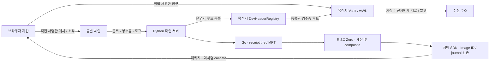

# 공용 Vault 브리지 구현 상세

2026-11-10에 검증한 `native-wl-vault-v1`의 기술 명세입니다. 실행과 지갑 사용은 [프로젝트 README](../README.md), 검증 단계와 재개 절차는 [개발 체크리스트](wl-vault-development-checklist.md), 거래와 증명의 실측값은 [종합 실행 근거](../results/wl-vault-validation/summary.json)에 있습니다.

## 1. 실행 구조

| 계층 | WorldLand 역할 · Anvil 31337 | BSC 역할 · Anvil 31338 |
| --- | --- | --- |
| 로컬 RPC | `http://127.0.0.1:8569` | `http://127.0.0.1:8570` |
| 출발 기능 | `NativeWLVault.lock`으로 네이티브 WL 예치 | `VaultWrappedWL.bridgeBurn`으로 wWL 소각 |
| 도착 기능 | `NativeWLVault.submitBurnProof`로 담보 지급 | `VaultWrappedWL.submitLockProof`로 wWL 발행 |
| 등록 루트 | BSC에서 관측한 블록의 영수증 루트 | WorldLand에서 관측한 블록의 영수증 루트 |
| 자산 이동 API action | `lock-vault` | `burn-vault` |

두 체인 앞에 Python API가 하나 있습니다. API는 `127.0.0.1:8584`에서 `wallet/`의 정적 파일을 제공하고, 운영자 루트 등록·영수증 패키지 조립·SDK 검증을 조율합니다. Go 생성기는 서명 없이 RPC를 읽고, Rust 호스트는 로컬 `r0vm`에서 영수증 연산을 증명합니다. 자산 거래와 목적지 청구는 브라우저 지갑에서 서명합니다. [Vault 실행기](../scripts/run-vault.sh) · [증명 API](../scripts/proof-service.py) · [Go 생성기](../proof-generator/cmd/bridge-proof/main.go) · [Rust 호스트](../risc0/receipt-computation/host/src/main.rs)



### 1.1 세션 초기화와 계약 연결

1. `run-vault.sh`가 전용 런타임 두 개를 확인하고 상태 디렉터리의 `launcher.lock`을 잡습니다. `local-session.py --vault`는 `native-wl-vault-v1`이 아닌 저장 상태를 거부합니다.
2. 세션은 두 Anvil 노드를 `127.0.0.1`에 열고 `wl-state.json`, `bnb-state.json`을 사용합니다. Anvil은 1초 상태 저장 간격과 과거 상태 보존 옵션으로 실행됩니다. `guard()`는 저장한 RPC의 루프백 URL·포트, 응답 체인 ID, PID의 Anvil 명령줄과 상태 파일 경로를 확인합니다. 포트에 이미 응답하는 서비스는 이 검사를 통과해야 합니다.
3. 첫 배포에서 각 체인에 반대 체인 ID로 `DevHeaderRegistry`를 배포합니다. WorldLand에 Vault, BSC에 wWL을 배포하고, wWL 생성자에 WorldLand Vault 주소를 넘깁니다. WorldLand 배포자가 `bindWrappedToken`을 한 번 호출해 반대편 주소를 연결합니다.
4. 다음 실행부터는 저장된 배포 주소를 사용합니다. `verify_bindings()`가 양쪽의 `sourceToken()`, `headerSource()`, `sourceChainId()`와 청구 주소 별칭을 대조한 뒤 세션을 `ready`로 표시합니다. 공개 manifest의 `sessionId`는 처음 한 번 만들어져 같은 상태를 열면 유지됩니다. [세션 구현](../scripts/local-session.py) · [실제 세션 매니페스트](../results/wl-vault-v1/session.json)

manifest는 `original`과 `unlock`을 WorldLand Vault에, `wrapped`와 `mint`를 BSC wWL에 매핑합니다. `wl_headers`와 `bnb_headers`는 각 목적지의 루트 등록 계약입니다. 로컬 기록에서 Vault와 wWL의 주소 문자열이 같아도 두 계약은 서로 다른 체인에 있습니다. 계약의 정체성은 체인 ID와 주소를 함께 사용하고, 브라우저는 현재 체인에서 읽은 런타임 코드도 manifest와 비교합니다. [manifest 생성](../scripts/proof-service.py) · [브라우저 매니페스트 검사](../wallet/client.mjs)

## 2. 자산 계약과 회계

### 2.1 WorldLand의 NativeWLVault

| 함수 또는 상태 | 동작 |
| --- | --- |
| `constructor(IHeaderSource headers)` | 로컬 체인 31337과 코드가 있는 등록 계약을 요구합니다. `headerSource`와 `deploymentOwner`를 고정하고 반대 체인 ID를 31338로 둡니다. |
| `bindWrappedToken(address token)` | 배포자가 0이 아닌 BSC 토큰 주소를 한 번 설정합니다. 이후 변경할 수 없습니다. 원격 주소는 초기 배포 설정의 일부이며 로컬 런처가 양쪽 연결을 대조합니다. |
| `lock(address recipient) payable returns (bytes32 id)` | 양수 `msg.value`, 0이 아닌 수신자, 바인딩 완료를 요구합니다. 실제로 받은 WL로 이동 ID를 만들고 송신자의 `lockNonce`와 `totalLocked`를 갱신한 뒤 `VaultLocked`를 기록합니다. |
| `submitBurnProof(Proof proof)` | 등록 루트에서 반대편 `VaultBurned`를 검증합니다. 미처리 ID와 회계상 남은 담보·실제 잔액을 확인하고, `claimedWithdrawal[id]`와 `totalReleased`를 갱신한 뒤 이벤트 수신자에게 네이티브 WL을 보냅니다. |
| `claimedWithdrawal(bytes32)` | 지급 청구가 성공한 소각 ID를 기록합니다. |
| `totalLocked`, `totalReleased` | 성공한 예치와 지급의 누적 기본 단위입니다. |

지급은 `recipient.call{value: amount}("")`으로 실행됩니다. 지급 전 처리 표시와 누계를 먼저 갱신하므로 같은 ID로 재진입해도 중복 지급할 수 없습니다. 수신 계약이 지급을 거부하면 `PayoutFailed`로 목적지 거래 전체가 되돌아가고, 청구 ID와 지급 누계도 원래 상태로 돌아옵니다. 수신자가 지급을 받을 수 있게 된 뒤 같은 ID로 다시 청구할 수 있습니다. 이미 완료된 BSC 소각은 그대로 남고, 그 소각에 기록된 수신자는 이후 청구로 바꿀 수 없습니다. [Vault 계약](../contracts/src/bridge/NativeWLVault.sol) · [지급 실패 재시도 테스트](../contracts/test/NativeWLVault.t.sol)

### 2.2 BSC의 VaultWrappedWL

| 함수 또는 상태 | 동작 |
| --- | --- |
| `constructor(IHeaderSource headers, address vault)` | 로컬 체인 31338에서 `Vault Wrapped WorldLand` · `wWL`을 생성합니다. 등록 계약, WorldLand Vault 주소와 출발 체인 31337을 고정합니다. 초기 공급은 0입니다. |
| `submitLockProof(Proof proof)` | 등록 루트에서 WorldLand Vault의 `VaultLocked`를 검증합니다. 처리되지 않은 ID에 한해 이벤트 수신자에게 같은 수량을 발행하고, `claimedTransfer[id]`와 `totalBridgeMinted`를 갱신합니다. |
| `bridgeBurn(uint256 amount, address recipient, uint256 destinationChainId)` | 보유자 잔액에서 wWL을 소각합니다. 양수 수량과 31337을 요구하고, 0 주소와 목적지 Vault 주소를 수신자로 거부합니다. `burnNonce`와 `totalBridgeBurned`를 갱신하고 `VaultBurned`를 기록합니다. |
| `transfer`, `approve`, `transferFrom` | 18자리 ERC-20 잔액과 승인 규칙에 따라 전송합니다. 일반 전송·승인은 브리지 누계에 영향을 주지 않습니다. |
| `claimedTransfer(bytes32)` | 발행이 성공한 예치 ID를 기록합니다. |

발행과 지급을 시작하는 공개 청구 함수는 이벤트의 수신자와 수량을 그대로 사용합니다. 청구 거래를 다른 지갑이 먼저 제출해도 해당 지갑으로 자산이 이동하지 않습니다. wWL 계약의 발행 진입점은 예치 증명을 검증하는 `submitLockProof`이고, Vault의 네이티브 지급 진입점은 소각 증명을 검증하는 `submitBurnProof`입니다. [wWL 계약](../contracts/src/token/VaultWrappedWL.sol) · [ERC-20 기본 구현](../contracts/src/token/MinimalERC20.sol)

### 2.3 누계와 대기 물량

다음 관계는 일관된 양쪽 체인 상태와 유효한 출발 이벤트를 기준으로 합니다. 단위는 18자리 정수 기본 단위입니다.

| 기호 | 값 |
| --- | --- |
| `L` | Vault의 `totalLocked` |
| `M` | wWL의 `totalBridgeMinted` |
| `B` | wWL의 `totalBridgeBurned` |
| `R` | Vault의 `totalReleased` |
| `S` | wWL의 `totalSupply` |

```text
아직 발행하지 않은 예치량  = L − M
아직 지급하지 않은 소각량  = B − R
wWL 공급량                = M − B
회계상 Vault 담보          = L − R
                          = S + (L − M) + (B − R)
```

예치와 발행, 소각과 지급은 각각 다른 체인 거래입니다. 중간에 멈춘 양은 대기 물량으로 남습니다. Vault 지급 상한은 `L - R`과 실제 잔액 중 작은 값이므로, 예치로 기록되지 않은 추가 잔액을 바탕으로 지급 한도를 늘릴 수 없습니다. UI의 양쪽 누계는 별도 RPC 요청에서 읽어 오므로 정확한 대조에는 일관된 스냅샷 또는 개별 이동 ID가 필요합니다. [Vault 회계](../contracts/src/bridge/NativeWLVault.sol) · [지갑 잔액 조회](../wallet/burn-mint-ui.mjs)

## 3. 이벤트와 도메인

출발 이벤트 두 개는 같은 필드 배치를 사용합니다. 첫 indexed ID의 이름은 예치에서 `transferId`, 소각에서 `withdrawalId`이고 API는 양쪽 모두 `transferId`로 다룹니다.

```text
VaultLocked(bytes32,address,address,uint256,uint64,uint256)
VaultBurned(bytes32,address,address,uint256,uint64,uint256)

topic[0]   = keccak256(이벤트 시그니처)
topic[1]   = 이동 ID
topic[2]   = 송신자 주소
topic[3]   = 수신자 주소
data      = abi.encode(amount, nonce, destinationChainId)
```

이동 ID는 ABI 정규 인코딩으로 다음 값을 해시합니다. 출발 계약 주소는 그 방향의 이벤트 발행 계약입니다. nonce는 방향의 출발 계약에서 송신자별로 관리하고 첫 성공 거래는 1을 사용합니다.

```solidity
bytes32 id = keccak256(abi.encode(
    keccak256("WORLDLAND_BNB_NATIVE_VAULT_V1"),
    sourceChainId,
    sourceContract,
    destinationChainId,
    destinationContract,
    sender,
    recipient,
    amount,
    nonce
));
```

예치 방향은 `31337/Vault → 31338/wWL`, 소각 방향은 `31338/wWL → 31337/Vault`입니다. 목적지 계약은 자신의 `block.chainid`와 `address(this)`를 넣어 ID를 다시 계산합니다. Solidity, Go, Rust guest, 브라우저가 같은 도메인과 이벤트 데이터를 확인합니다. [Solidity ID 및 로그 검증](../contracts/src/bridge/VaultReceipt.sol) · [Go 이벤트 디코더](../proof-generator/internal/receipt/event.go) · [Rust 연산 코어](../risc0/receipt-computation/core/src/lib.rs) · [브라우저 검증](../wallet/client.mjs)

목적지의 `LockClaimed(bytes32,address,uint256)`와 `BurnClaimed(bytes32,address,uint256)`는 각각 발행·지급 완료를 나타냅니다. 지갑은 현재 방향의 해당 계약에서 `claimedTransfer` 또는 `claimedWithdrawal`을 조회해 기록의 완료 여부를 확인합니다. [지갑 기록 조회](../wallet/burn-mint-ui.mjs)

## 4. 루트 등록과 Go 영수증 증명

1. **이벤트 선택과 확인 깊이.** 요청 방향의 계약 주소·이벤트 topic·이동 ID로 출발 로그를 조회합니다. API는 유일한 현재 이벤트의 실제 블록 번호를 저장합니다. 기본 런처는 이벤트가 있는 블록보다 출발 높이가 2 이상 높아질 때 진행하며, 로컬 데모에서는 유일한 이벤트 확인 뒤 필요한 빈 블록을 Anvil에서 생성합니다.
2. **목적지 루트 등록.** 서버가 출발 블록의 번호·해시·`receiptsRoot`를 읽습니다. 해당 루트가 빠져 있으면 로컬 운영자가 목적지 `DevHeaderRegistry.registerHeader`를 호출합니다. 등록 전후에 출발 블록을 다시 읽고 등록된 루트를 대조합니다. 등록 계약은 잘못된 출발 체인·빈 값·같은 블록 번호의 다른 해시 또는 루트를 거부합니다. 같은 번호·해시·루트의 반복 등록은 안전합니다.
3. **영수증 수집.** Go RPC 어댑터는 블록의 거래 해시 목록과 전체 영수증을 가져옵니다. `eth_getBlockReceipts`를 먼저 사용하고, 호출이 실패하거나 개수가 맞지 않으면 `eth_getTransactionReceipt`로 거래 순서대로 수집합니다. 영수증과 로그의 블록·거래 해시와 인덱스를 검증합니다.
4. **트라이 재구성.** 트라이의 키는 거래 인덱스의 RLP 인코딩이고, 값은 합의 형식으로 인코딩한 영수증입니다. 지원하는 형식은 legacy와 typed receipt 1–4입니다. 재구성한 루트는 RPC 블록의 `receiptsRoot`와 일치해야 합니다. 대상 거래는 성공 영수증이어야 합니다.
5. **포함 증명과 청구 데이터.** 필터링한 로그와 영수증 안의 로그를 대조해 receipt-local `logIndex`를 확정하고 MPT 노드를 추출합니다. Go에서 자체 재검증한 뒤 목적지 등록 루트와 청구 계약의 체인·상대 자산·등록 계약 바인딩도 조회합니다. 마지막으로 출발 블록 해시·루트와 확인 깊이를 다시 확인합니다. [루트 등록 서비스](../scripts/proof-service.py) · [RPC 어댑터](../proof-generator/internal/chain/adapter.go) · [영수증 인코딩](../proof-generator/internal/receipt/encoding.go) · [트라이 증명](../proof-generator/internal/receipt/proof.go)

`txIndex`는 블록 안의 거래 인덱스, `logIndex`는 그 거래 영수증 안의 로그 인덱스입니다. `eth_getLogs`의 블록 전체 로그 번호를 청구 calldata에 그대로 쓰면 같은 블록의 다른 로그 때문에 잘못된 항목을 참조할 수 있습니다. MPT는 주어진 루트 아래의 영수증 포함을 확인하며, 원본 블록의 합의 여부는 루트 등록 신뢰에 따릅니다. [공통 Solidity 영수증 검증기](../contracts/src/bridge/MPTReceiptProofCore.sol)

### 4.1 목적지 ABI

두 방향의 청구 인자는 같은 구조입니다.

```solidity
struct Proof {
    uint256 blockNumber;
    bytes32 blockHash;
    uint256 txIndex;
    uint256 logIndex;
    bytes[] proofNodes;
}
```

| 방향 | 청구 함수 | replay 조회 |
| --- | --- | --- |
| WorldLand → BSC | `VaultWrappedWL.submitLockProof(Proof)` | `claimedTransfer(transferId)` |
| BSC → WorldLand | `NativeWLVault.submitBurnProof(Proof)` | `claimedWithdrawal(transferId)` |

Solidity가 등록된 루트를 조회한 뒤 포함 증명에서 성공 영수증과 로그를 읽습니다. `VaultReceipt.verify`는 emitter, 토픽 수·시그니처, 정규 주소, 96바이트 데이터, 양수 수량·nonce, 목적지 체인과 이동 ID를 대조합니다. 각 목적지 계약이 replay 표시와 자산 이동을 처리합니다. 청구 tuple에 들어가는 증거는 MPT 노드이며, RISC Zero composite는 브라우저와 서버 사이의 패키지에 들어갑니다. [청구 ABI 인코더](../proof-generator/internal/receipt/calldata.go) · [온체인 검증](../contracts/src/bridge/VaultReceipt.sol)

## 5. RISC Zero 연산 증명

| 항목 | Vault 값 |
| --- | --- |
| guest 기능 | Cargo `vault` feature |
| 서비스 프로필 | `native-wl-vault-v1` |
| Go 패키지와 guest journal 버전 | 3 |
| 고정 Image ID | `1b0417939d1f2ccd49bb3c037def83ebf4a63857fe1ff91ae6154b1a5702a310` |
| receipt 형식 | `risc0-sdk-bincode-3.0.5`, `InnerReceipt::Composite` |
| statement | `trusted-input-receipt-computation` |
| 검증 위치 | `server-risc0-sdk` |

호스트 빌드의 `vault` feature는 host-side 코어와 RISC-V guest 모두에 같은 검증 기능을 활성화합니다. 호스트는 guest ELF와 ID를 포함하고, 서비스는 `configs/vault-computation.json`의 정책을 로드합니다. 내부 manifest의 `mode: "dev"`는 로컬 신뢰 루트 경로를 가리키며, 증명에 필요한 실제 composite는 SDK가 검사합니다. [Vault 정책](../configs/vault-computation.json) · [guest 빌드 설정](../risc0/receipt-computation/methods/build.rs) · [SDK 호스트](../risc0/receipt-computation/host/src/main.rs)

### 5.1 입력과 journal

SDK로 전달하는 입력 필드는 다음 순서로 구성됩니다. `amount`는 10진 정수 문자열, 인덱스·체인 ID·nonce는 JSON 숫자, 주소·해시·RLP·MPT 노드는 16진 문자열입니다.

```text
action, sourceChainId, destinationChainId, sourceToken, destinationToken,
sender, recipient, amount, nonce, transferId, blockNumber, blockHash,
receiptRoot, txIndex, logIndex, receiptBytes, proofNodes
```

Guest는 루트부터 MPT 경로를 순회하고 얻은 값과 `receiptBytes`를 비교합니다. 성공 영수증에서 지정 로그를 읽고 이벤트 서명, 송신자·수신자, 금액·nonce·체인과 이동 ID를 다시 계산합니다. `inputDigest`는 Rust가 입력 구조체를 직렬화한 JSON 바이트의 Keccak-256입니다. journal은 그 digest와 action, 출발·목적 체인과 자산, 수신자, 수량, ID, 블록 번호·해시, 영수증 루트 및 `sourceAuthenticated: false`를 공개합니다. 송신자, nonce, 전체 증거 노드도 입력 digest에 묶입니다. [입력과 guest 검증 규칙](../risc0/receipt-computation/core/src/lib.rs) · [Python 입력 선택](../scripts/receipt-computation.py)

### 5.2 생성, 검증과 전달

- 호스트가 동일 입력을 네이티브 코드로 먼저 검증해 기대 journal을 계산합니다. `prove`는 `ProverOpts::composite()`로 증명하고 SDK의 Image ID 검증 및 guest journal 비교까지 통과해야 receipt를 저장합니다. 완성한 receipt는 임시 파일에서 `receipt.bin`으로 교체합니다.
- `verify`는 bincode를 복호화해 composite 형식과 고정 guest ID를 검사하고, SDK가 읽은 journal을 입력의 기대값과 비교합니다. 서비스가 돌려주는 `sdkVerified: true`는 이 경로를 통과한 결과입니다. 호스트의 `execute` 결과는 SDK 검증된 청구 증거로 취급되지 않습니다.
- API의 `computationProof`에는 `receiptBase64`, `receiptSHA256`, `imageId`, `receiptFormat`, `journal`, 검증 범위가 들어갑니다. 브라우저는 receipt 바이트의 SHA-256과 journal 입력 commitment를 확인한 뒤, SDK 재검증 API의 journal·Image ID·receipt 해시와 비교합니다.
- 생성 프로세스의 파일당 상한은 64 MiB입니다. HTTP에서 전송하는 원본 composite 바이트는 8 MiB, 전체 검증 요청과 job JSON은 16 MiB로 별도 제한됩니다. [SDK 호스트](../risc0/receipt-computation/host/src/main.rs) · [composite 전달·검증](../scripts/receipt-computation.py) · [브라우저 SDK 호출](../wallet/client.mjs)

## 6. HTTP API와 작업 상태

| 요청 | 결과 |
| --- | --- |
| `GET /` | Vault 지갑 홈 `/vault.html`로 이동합니다. |
| `GET /api/manifest` | 체인, 주소, 런타임 바이트, 세션 ID, 신뢰 모델과 고정 SDK 정책을 제공합니다. guest ID는 `computationProof.imageId`를 사용합니다. |
| `GET /api/health` | 작업 스레드의 생존 여부를 200 또는 503으로 반환합니다. |
| `GET /api/chains` | 양쪽 RPC 연결 여부와 최근 블록을 조회합니다. |
| `POST /api/jobs` | `action`, `transferId`, `fromBlock`을 받고 작업 상태를 202로 반환합니다. |
| `GET /api/jobs?action=lock-vault` 또는 `burn-vault` | 해당 방향의 저장된 작업 상태 목록을 반환합니다. |
| `GET /api/jobs/{jobId}` | 상태, 요청, 상세 메시지, 생성·수정 시각을 반환합니다. |
| `GET /api/jobs/{jobId}/package` | `ready` 상태에서 출발 블록·확인 깊이·등록 루트와 SDK를 다시 확인한 뒤 패키지를 반환합니다. |
| `POST /api/computation/verify` | 패키지의 composite를 SDK에서 다시 검증하고, 현 세션·출발 블록·확인 깊이·목적지 루트를 확인합니다. |
| `GET /api/audit?after=0&limit=100` | 공개 감사 기록, 마지막 digest, 양 체인의 앵커와 긴급 정지 상태를 조회합니다. |
| `GET /api/transactions?chain=wl&from=0` | 지정 체인의 관련 계약 로그를 최대 2,000블록 범위로 읽습니다. `chain=bnb`도 지원합니다. |
| `POST /rpc/wl`, `POST /rpc/bnb` | 허용된 JSON-RPC 조회와 이미 서명된 raw transaction 전달을 지원합니다. |

증명 요청의 `fromBlock`은 검색 하한입니다. 동일한 출발 로그를 찾으면 서비스가 실제 이벤트 블록 번호로 정규화합니다. action, 소문자 이동 ID, 정규화한 블록 번호를 키 정렬 JSON으로 직렬화한 뒤 SHA-256으로 job ID를 계산합니다. 같은 이벤트의 복구 요청은 같은 job으로 합쳐지며, 기존 `ready` 작업은 새 증명 없이 그 상태를 반환합니다. 세션당 진행 중인 작업은 최대 256건입니다. 완료된 작업은 이 한도에 포함되지 않습니다. [작업 ID·조회·요청 처리](../scripts/proof-service.py)

```text
queued → running → ready
            ├──→ waiting_confirmations → running
            └──→ failed → 같은 이벤트 재요청 → queued
```

작업 상태는 `proof-jobs/<jobId>.json`에 저장합니다. `ready` 패키지 조회에서 출발 블록이 달라지거나 확인 깊이를 잃으면 서비스가 패키지를 제거하고 실패 상태로 바꿀 수 있습니다. 준비 단계의 작업 목록과 상세 조회에는 전체 패키지가 포함되지 않습니다. 등록 루트가 같고 composite가 유효한 경우에만 동일 증거를 다시 제공합니다. [상태 전이와 재검증](../scripts/proof-service.py)

### 6.1 요청과 권한 제한

- API는 `127.0.0.1` 루프백에서만 실행합니다. Host와 Origin을 확인하고, 증명 요청과 SDK 검증 POST에는 `X-Bridge-Request: 1` 및 `Content-Type: application/json`을 요구합니다. 작업 POST의 body는 4 KiB, SDK 검증은 16 MiB입니다.
- RPC 브라우저 경로는 읽기와 `eth_sendRawTransaction`만 허용합니다. raw transaction은 16진 인코딩을 요구하며, 체인과 서명 유효성은 로컬 RPC가 검사합니다. RPC 요청 body는 64 KiB입니다. HTTP 동시 처리 슬롯은 32개입니다.
- 배포·등록·감사는 세션이 소유한 Anvil 테스트 운영자 경로에서 실행합니다. 브라우저 RPC에서 unlocked 사용자 거래나 노드 관리 메서드를 호출할 수 없습니다. 정적 지갑과 API 응답에는 같은 출처 중심 CSP, `nosniff`, `no-store`가 적용됩니다. [HTTP 처리기](../scripts/proof-service.py) · [RPC 허용 목록](../scripts/http-config.py)

### 6.2 저장된 예치 작업 조회 예시

다음 요청은 로컬 검증에 사용한 예치 작업을 조회합니다. 첫 두 요청은 상태와 정책을 읽고, 세 번째 요청은 해당 작업의 패키지를 서버에서 다시 검증한 뒤 반환합니다.

```bash
vault_api=http://127.0.0.1:8584
vault_job=05718d26430c3d69fe683ee9e9ca4d591d467372f35139625323c5b247ac69b2

curl -fsS "$vault_api/api/manifest"
curl -fsS "$vault_api/api/jobs/$vault_job"
curl -fsS "$vault_api/api/jobs/$vault_job/package"
```

패키지에는 `version`, 양쪽 체인·자산, `sender`, `recipient`, 수량과 nonce, 블록·영수증 위치와 루트, `receiptBytes`, `proofNodes`가 들어갑니다. `claimTransaction`은 `role: "user"`, 목적지 체인 ID, `to`, `data`, `value: "0"`와 청구 메서드를 담은 미서명 객체입니다. 이 객체의 목적지와 calldata는 브라우저가 직접 재구성한 값과 같아야 합니다. `computationProof`는 별도로 SDK 검증에 사용합니다. [패키지 필드](../proof-generator/cmd/bridge-proof/main.go) · [브라우저의 청구 데이터 검증](../wallet/client.mjs) · [저장된 예치 작업 근거](../results/wl-vault-validation/summary.json)

## 7. 브라우저 지갑과 거래 기록

- **구성.** `vault-deposit.html`, `vault-release.html`, `vault-tools.html`은 공통 단계 렌더러를 Vault 프로필로 사용합니다. `WalletClient`가 예치·소각·청구 검증을 수행하고, `BurnMintClient`가 전송·승인·대리 전송 및 WorldLand 네이티브 전송을 지원합니다. [단계 렌더러](../wallet/burn-mint-page.mjs) · [거래 검토 코드](../wallet/client.mjs) · [전송 클라이언트](../wallet/burn-mint-client.mjs)
- **연결과 서명.** 공개 Anvil 데모 지갑은 브라우저 메모리에서 서명하고 서명된 바이트만 로컬 RPC로 보냅니다. 확장 지갑 경로는 EIP-1193을 사용합니다. 예치 미리보기는 `lock(address)`와 native value를 묶고, 소각은 wWL 보유량과 지정 수신자·체인을 확인합니다. 시뮬레이션과 가스 추정 결과로 잔액을 대조합니다. [데모 지갑](../wallet/demo-wallet.mjs) · [출발 거래 확인](../wallet/client.mjs)
- **청구 서명.** manifest와 패키지의 버전·체인·계약, MPT, 이벤트, 이동 ID, calldata를 검증합니다. 실제 SDK 응답, 목적지 런타임 코드와 등록 루트, replay 상태, `eth_call`·가스 추정을 확인합니다. 서명 직전에 미리보기를 다시 실행해 계정·체인 변경이나 이미 처리된 ID를 잡습니다. 서명자와 지급·발행 수신자는 별도 값으로 표시됩니다. [청구 미리보기와 제출](../wallet/client.mjs)
- **기록 조회.** 브라우저는 출발 이벤트에서 연결한 주소를 송신자·수신자 양쪽으로 조회하고, 2,000블록 단위로 읽은 결과를 ID로 합칩니다. 증명 서버의 상태와 목적지 처리 여부를 결합해 예치·소각량, 발행·지급량, 단계와 복구 링크를 표시합니다. 발행·지급은 이벤트 수량 전부를 한 청구에서 처리하므로, 기록에는 완료 전 0과 완료 후 해당 수량을 표시합니다. [기록 재구성과 화면 상태](../wallet/burn-mint-ui.mjs)
- **브라우저 저장.** 키에는 프로필과 세션 ID가 들어가고, 미확인 거래는 연결 계정으로 분리됩니다. 자산 거래 전에 nonce·거래 내용을 기록하고 서명 응답 뒤에는 해시를 추가합니다. Web Locks로 같은 계정의 여러 탭 제출을 직렬화합니다. 해시를 받은 경우 영수증을 조회해 이어가며, 해시가 없는 상태에서는 사용자가 지갑 내역을 확인할 때까지 자동 재전송을 막습니다. [미확인 거래 복구](../wallet/burn-mint-ui.mjs)

## 8. 상태, 재시작과 자원 제한

| 파일 또는 잠금 | 역할 |
| --- | --- |
| `results/wl-vault-v1/session.json` | 프로필, 노드·체인 정보, 계약 주소, 운영자와 공개 데모 계정, 세션 ID |
| `wl-state.json`, `bnb-state.json` | Anvil 상태와 재시작에 필요한 체인 데이터 |
| `launcher.lock`, `client.lock`, `proof-service.lock` | 런처, 세션 CLI, API의 중복 실행 제한 |
| `trusted-root.lock` | 목적지 루트 등록의 직렬화 |
| `results/receipt-computation.lock` | 저장소 전역 증명 실행 잠금 |
| `proof-jobs/<jobId>.json` | 작업 입력과 상태, 준비된 패키지 |
| `proof-jobs/<jobId>-receipt-<inputSHA256>/` | 입력 JSON, composite, SDK 요약·로그와 실행 계측 |
| `audit-journal.jsonl`, `audit-anchor-pending.json`, `audit-stop.json` | 감사 기록, 앵커 재시도와 확인된 사고 상태 |

캐시 digest는 **모든 guest 입력을 담은 압축 JSON 바이트의 SHA-256**입니다. journal의 Keccak-256 `inputDigest`와 역할이 다릅니다. 새 입력은 다른 캐시 디렉터리를 사용합니다. 같은 입력에서 완성된 `receipt.bin`이 있으면 SDK `verify`로 재사용합니다. 작업 JSON은 임시 파일 후 교체로 저장합니다. 재시작할 때 중단된 `running` 작업은 `queued`로 복구하고, 이미 준비된 작업은 같은 ID로 읽습니다. [캐시 처리](../scripts/receipt-computation.py) · [작업 복구](../scripts/proof-service.py)

| 항목 | 제어 방식 |
| --- | --- |
| CPU | affinity와 확인 가능한 cgroup quota를 고려해 최대 12개. RISC Zero·Rayon·OMP 스레드에도 전달 |
| 메모리 | 시스템과 확인 가능한 cgroup의 현재 가용량 중 작은 값의 70%. 증명 프로세스 그룹의 RSS를 주기적으로 합산 |
| 증명 시간 | 실행 상한 1,800초. 서비스 측 외부 타임아웃은 정리 시간을 포함해 1,830초 |
| 파일 크기 | 증명 프로세스의 파일당 64 MiB 제한 |
| 독립 SDK 검증 | 서비스 타임아웃 30초. 새로운 proving을 시작하지 않음 |

제한을 넘거나 종료 신호가 오면 소유 프로세스 그룹을 정리합니다. `RISC0_DEV_MODE`, `BONSAI_API_KEY`, `BONSAI_API_URL`은 서비스의 하위 증명 프로세스 환경에서 제거됩니다. job의 실행 계측 `run-result.json`에는 사용한 입력·호스트 해시와 실제 실행 시간·최대 RSS·상한·종료 상태가 남습니다. [실행 제한](../scripts/run-receipt-computation.py) · [가용량 계산](../scripts/runtime-config.py)

## 9. 감사와 정지 경로

공개 감사 레코드는 순번·시각·종류·데이터·직전 digest를 저장하고 정규 JSON의 SHA-256으로 체인을 구성합니다. 작업 상태 변경, raw transaction 전달 결과, 확인된 사고를 기록합니다. 최신 digest는 운영자 거래로 양 체인의 별도 감사 계약에 앵커링합니다. 프로세스가 기록 후 앵커링 전에 종료되면 pending 파일을 사용해 다음 실행에서 다시 확인합니다. 감사 앵커는 기록 변조 탐지에 쓰이며 출발 체인 합의의 증거와 별개입니다. [감사 기록 구현](../scripts/bridge-audit.py) · [감사 계약](../contracts/src/bridge/BridgeAuditLog.sol)

작업 스레드는 등록된 루트와 출발 RPC 블록을 대조합니다. 해시·루트가 어긋나고 재조회에서도 같은 불일치가 나오면 사고 상태를 로컬에 기록하고, 감사 계약과 각 등록 계약의 내부 감사 가드에 정지를 전달합니다. 등록 계약의 `getReceiptRoot`도 이 가드를 사용하므로, 정지가 반영되면 기존 루트를 사용하는 신규 청구도 실패합니다. 출발 계약의 예치·소각 자체는 이 등록 루트 가드를 조회하지 않습니다. 긴 증명과 감사 점검은 같은 작업 스레드에서 실행되므로 점검 주기는 proving 중 늘어날 수 있습니다. [루트 등록·정지 가드](../contracts/src/bridge/DevHeaderRegistry.sol) · [작업 루프](../scripts/proof-service.py)

## 10. 신뢰 경계와 실운영 범위

| 판단 | 현재 구현의 근거 |
| --- | --- |
| 영수증과 이벤트의 포함 여부 | Go·guest·브라우저·Solidity가 주어진 루트에 대해 계산합니다. |
| 등록 루트의 출처 | 출발 RPC와 로컬 운영자를 신뢰합니다. 운영자가 등록한 루트가 목적지 계약의 기준입니다. |
| RISC Zero composite 검증 | 서버 SDK에서 고정 Image ID와 실제 journal을 검증합니다. 브라우저 청구 흐름도 SDK 검증을 요구합니다. |
| EVM에서 직접 청구 | 계약이 등록 루트·MPT·이벤트·도메인·replay를 확인합니다. EVM calldata에는 composite가 없으므로, 계약의 직접 호출 조건에는 SDK 검증이 포함되지 않습니다. |
| 잔액 안전성 | 청구 ID와 수량은 목적지 계약에서 검증하고, Vault는 회계상 담보와 실제 잔액을 대조합니다. 운영자가 정직한 루트를 등록한다는 전제가 있습니다. |
| 체인 최종성 | 로컬의 확인 깊이와 출발 RPC 재조회로 정책을 적용합니다. 원본 합의와 최종성의 독립 인증은 실증 범위 밖입니다. |

운영자가 잘못된 루트를 등록할 수 있다는 점은 이 신뢰 모델의 핵심입니다. 루트와 일관된 위조 영수증은 포함 검증을 통과할 수 있으므로, 증명은 루트 등록 권한 자체를 대신하지 않습니다. 실제 체인으로 확장하려면 RPC와 영수증 포맷, 확인 깊이·재구성 처리, 운영자 키와 루트 등록·정지 정책, 계약·지갑 배포 절차와 실자산 검증을 별도로 확인해야 합니다. [루트 검증 기준](../contracts/src/bridge/DevHeaderRegistry.sol) · [Vault 검증 범위](wl-vault-development-checklist.md)

## 11. 빌드와 검증 재현

### 11.1 전용 바이너리

```bash
mkdir -p .bin
go -C proof-generator build -buildvcs=false -o ../.bin/bridge-vault-proof ./cmd/bridge-proof
cargo build --release --locked --manifest-path risc0/receipt-computation/Cargo.toml \
  -p bridge-receipt-host --features vault
```

설치 전에 새 호스트를 저장된 Vault receipt의 복사본으로 검증하고 `summary.json`의 Image ID를 정책과 비교할 수 있습니다. 아래 검사는 복사한 receipt를 검증하며 새로운 증명을 생성하지 않습니다.

```bash
python3 - <<'PY'
import json
from pathlib import Path
import shutil
import subprocess
import tempfile

root = Path.cwd()
policy = json.loads((root / 'configs/vault-computation.json').read_text())
evidence = json.loads((root / 'results/wl-vault-validation/summary.json').read_text())
cache = (root / evidence['proofs']['lock']['receipt']).parent
host = root / 'risc0/receipt-computation/target/release/bridge-receipt-host'

with tempfile.TemporaryDirectory(prefix='vault-sdk-check-') as name:
    check = Path(name)
    for filename in ('input.json', 'receipt.bin'):
        shutil.copyfile(cache / filename, check / filename)
    subprocess.run([str(host), 'verify', str(check / 'input.json'), str(check)], check=True)
    verified = json.loads((check / 'summary.json').read_text())
    assert verified['sdkVerified'] is True
    assert verified['imageId'] == policy['imageId']
PY
install -m 755 risc0/receipt-computation/target/release/bridge-receipt-host .bin/bridge-vault-receipt-host
```

기존 검증 세션의 정상 실행에는 Cargo·Foundry 빌드 캐시 대신 설치한 바이너리를 사용합니다. 새 세션의 계약 배포에는 Foundry 컴파일 도구가 필요합니다. `r0vm`은 `RISC0_SERVER_PATH`, PATH 또는 런타임의 후보 경로에서 확인합니다. [Vault 실행기](../scripts/run-vault.sh) · [런타임 경로](../scripts/runtime-config.py)

### 11.2 인수 검사와 저장된 근거

브라우저 검사는 기본 상태 경로에서 작업합니다. 브라우저 검사의 저장 지점은 `results/wl-vault-validation/browser-resume.json`이고, 이동 ID와 함께 거래 서명자·nonce·해시가 기록됩니다. 재개 시 체인에서 이미 채굴된 거래를 대조한 뒤 다음 단계로 넘어갑니다. `check-vault-restart.py`는 `prove-lock`, `prove-burn`에서 활성 proving과 전역 잠금을 확인하고 기존 작업을 재사용합니다. `snapshot`·`compare`는 지급 전에 두 노드를 재시작하고 동일한 입력·루트·증명·잔액이 보존되는지 확인합니다. [브라우저 검사](../scripts/check-vault-browser.mjs) · [재시작 검사](../scripts/check-vault-restart.py) · [실행 순서](wl-vault-development-checklist.md)

| 결과 | 확인 근거 |
| --- | --- |
| 서명 6건 | 예치, 발행, wWL 전송, 소각, WL 지급, WL 재전송. [브라우저 요약](../results/wl-vault-validation/browser-summary.json) |
| 예치·소각 composite | 248.63초와 258.70초, 각각 537,340바이트, 최대 RSS 약 4.94 GB. 두 작업 모두 SDK 검증과 자원 제한 통과. [종합 실행 결과](../results/wl-vault-validation/summary.json) |
| 재시작 후 동일 증거 | 두 노드 PID 변경, 블록·루트·잔액·receipt SHA-256·크기·수정 시각 보존, 신규 증명 0건. 복구 요청 두 건은 기존 job ID 반환. [재시작 대조](../results/wl-vault-validation/restart-result.json) |
| 잔액 대조 | 총예치 10 WL, 총지급 10 WL, 최종 Vault 잔액 0 WL과 wWL 공급 0, 수신자가 2 WL 재전송. [브라우저 요약](../results/wl-vault-validation/browser-summary.json) |
| 실패와 회귀 | 잘못된 체인·수신자·수량·composite, 두 방향 replay를 거부했습니다. Solidity 52개에는 Vault의 담보 부족과 지급 실패 후 재시도 검사가 포함됩니다. 지갑 16개와 Go·Rust·자원 제한 검사도 통과했습니다. [Solidity 검사 로그](../results/wl-vault-validation/solidity-tests.log) · [종합 실행 결과](../results/wl-vault-validation/summary.json) |
