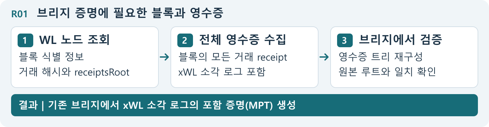
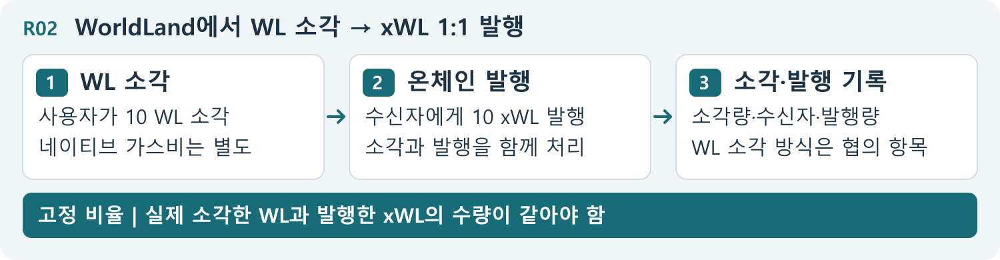
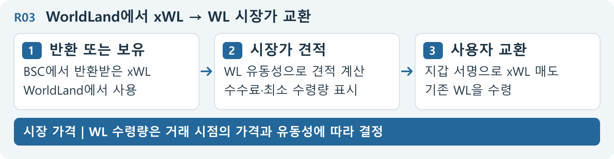

# WL 운영자 면담 요청서

## R01. 증명용 체인 데이터 API 제공

**WorldLand에서 발생한 xWL 소각을 BSC에서 검증할 수 있도록, 블록의 영수증 루트와 전체 거래 영수증을 조회할 수 있는 API를 요청합니다.**

### 제공을 요청하는 데이터

| 구분 | 제공 항목 |
| --- | --- |
| 블록 | 번호·해시·부모 해시, `receiptsRoot`, 실행 순서대로 정렬된 거래 해시 목록 |
| 전체 영수증 | 블록 내 모든 거래의 `type`, `status`, `cumulativeGasUsed`, `logsBloom`, `logs` |
| 식별과 로그 | 블록 번호·해시, 거래 해시·인덱스, 로그의 발행 주소·topics·data·순서 |
| 조회 조건 | 최신 높이, 번호·해시 기반 블록 조회, 주소·topic·높이 범위에 따른 로그 조회 |

### 제공 방식과 운영 조건

- 공식 RPC에서 `eth_getBlockByNumber`, `eth_getBlockByHash`, `eth_getTransactionReceipt`, `eth_getLogs`, `eth_blockNumber`, `eth_chainId`의 지원 범위를 확인합니다. Explorer API도 같은 데이터를 제공하면 사용할 수 있습니다.
- 블록 단위 `eth_getBlockReceipts`가 있으면 한 번에 조회합니다. 거래별 receipt 조회로도 전체 블록을 재구성할 수 있습니다.
- 과거 데이터 보존 기간, 호출·응답 크기 한도, 인증 방식과 장애 시 대체 주소를 공유받습니다.

### 확인할 결과

xWL 소각 거래와 일반 거래가 함께 들어 있는 블록 샘플을 제공받습니다. 전체 영수증으로 계산한 루트가 원본 `receiptsRoot`와 같고, xWL 소각 로그의 포함 증명이 검증되면 데이터 요구사항을 충족합니다. [S2·S3·S6]

<!-- pagebreak -->

## R02. WL 소각과 xWL 1:1 발행

**실제 소각한 WL과 같은 수량의 xWL을 받을 수 있도록, WorldLand에서 WL 소각과 xWL 발행을 한 거래로 처리하는 경로를 요청합니다.**

### 계약에서 보장할 조건

1. **WL 소각.** 사용자가 WorldLand 지갑에서 수량과 xWL 수신자를 확인하고 거래를 서명합니다. 계약은 사용자가 보낸 WL을 합의된 소각 경로로 보냅니다.
2. **동일 수량 발행.** 실제 소각한 수량만큼 xWL을 발행합니다. 예를 들어 10 WL을 소각하면 10 xWL을 받습니다. 가스비는 별도입니다.
3. **원자적 처리.** WL 소각과 xWL 발행·이벤트를 한 거래로 처리합니다. 어느 단계에서든 실패하면 함께 되돌립니다.

### WL 측에 확인할 사항

- 기존 전송 규칙에서 회수 경로가 없는 소각 주소를 쓸 수 있는지, 공식 공급량 집계에는 어떻게 반영되는지 확인합니다.
- 소각 경로, xWL 주소와 단위, 진입 발행·브리지 발행의 권한 경계를 합의합니다. xWL은 ERC20으로 구현합니다. [S5]
- WorldLand 개발망에서 소각 전송과 xWL 발행·실패 영수증을 확인합니다.

### 확인할 결과

성공 거래에서 소각량과 xWL 발행량이 일치하며, 소각 없이 발행하려는 요청은 거부됩니다. 소각·발행 누계는 각각 조회할 수 있어야 합니다.

<!-- pagebreak -->

## R03. WorldLand에서 xWL → WL 시장가 교환

**BSC에서 돌아온 xWL을 기존 WL로 바꿀 수 있도록, 실제 유동성에 기반해 시장가로 체결되는 WorldLand 교환 경로를 요청합니다.**

### 교환 인프라에서 확인할 조건

| 항목 | 협의할 내용 |
| --- | --- |
| 교환 경로 | 사용 가능한 WorldLand 거래소 또는 풀, 지원 자산과 라우터 주소 |
| 유동성 | xWL과 기존 WL의 공급 주체, 초기 규모, 거래 중단·재개 기준 |
| 견적과 실행 | 예상 WL 수령량, 수수료, 최소 수령량과 거래 기한 |
| 정산 | 사용자가 지갑에서 거래를 서명하고 거래 상대나 풀이 보유한 WL을 지급 |

WL→xWL 1:1 발행과 xWL→WL 시장가 교환은 별도 경로입니다. 예를 들어 반환한 10 xWL의 시장가가 개당 0.8 WL이면 수수료 전 견적은 8 WL입니다.

### 기존 브리지 연결

WorldLand의 xWL과 BSC의 wWL은 기존 burn·mint 브리지로 1:1 전환합니다. xWL을 소각하면 BSC에서 같은 수량의 wWL을 받고, wWL을 소각하면 WorldLand에서 같은 수량의 xWL을 받습니다. 소각 증명·검증과 지갑 서명 흐름을 재사용하고 양쪽 토큰 주소를 새 배포 설정에 연결합니다.

### 확인할 결과

wWL을 소각해 받은 xWL로 WorldLand 시장가 견적을 받고, 최소 수령량 조건을 만족하면 기존 WL을 수령합니다.

<!-- pagebreak -->

## 추가 협의사항 · 노드와 신뢰 정책

### R04. 운영 노드 버전과 개발 범위

메인넷·테스트넷의 release/commit, EVM fork, 지원 거래·receipt 형식, 진행 중인 업그레이드를 확인합니다. 현행 소스 ref, 빌드·실행 방법, genesis/chain 설정과 개발 담당자를 공유받아 ERC20 계약 배포와 연동 환경을 확인합니다. [S1]

### R05. 자산·이벤트 식별 규칙

양쪽 chain ID, WL 시스템 주소, BSC wWL 주소, 버전·도메인, 자산 단위, nonce·소각 ID 계산식을 고정합니다. ABI와 배포 설정, 다른 수신자에게 반환하는 사례와 부분 반환 테스트 벡터를 합의합니다.

### R06. 승인 루트 등록과 키 관리

BSC block hash·receiptsRoot 등록 담당자, 최초 등록과 상충 처리, 권한 교체·정지 절차를 확정합니다. 루트 승인 권한을 발행 실행 권한과 분리하고, 등록 이력과 승인 기준을 기록합니다.

### R07. Confirmation과 재구성 처리

체인별 대기 블록 수, 노드 간 불일치 시 보류 기준, 증명 생성 후와 청구 직전의 재확인 절차를 정합니다. WL 운영팀에 재구성 사례와 권고 대기 기준을 요청합니다. 원본 소각이 사라지거나 확인 수가 줄면 청구를 보류하고, 깊은 재구성은 별도 사고 대응 절차에 포함합니다.

<!-- pagebreak -->

## 추가 협의사항 · 통합 검증과 운영

### R08. 공급량·장부·탐색기 표시

WL 소각에 따른 xWL 발행 누계와 양쪽 브리지 소각·발행 누계를 구분합니다. 소각 ID 처리 상태와 양 체인의 대조에 사용할 안전 높이를 정하고, 탐색기 표시 방식을 합의합니다.

### R09. 가스와 실패 처리

MPT 노드 수·증거 크기 한도와 가스 비용을 측정합니다. 소각·발행과 브리지 실행이 실패했을 때 자산 잔액과 기록이 일관되게 되돌아가는지 확인합니다. 시장가 교환의 가스비와 최소 수령량 조건도 확인합니다.

### R10. 개발망과 시험 데이터

사용 가능한 devnet/testnet RPC, 시험용 WL, 로그·탐색기 접근, 초기화·재시작 절차를 요청합니다. 다중 거래 블록, 소각·발행·실패 영수증과 재구성 재현 환경을 확보합니다. 공식 개발 문서는 Gwangju 테스트넷 주소를 팀에 문의하도록 안내합니다. [S4]

### R11. 정지와 청구 복구

RPC 장애·루트 불일치 시 소각과 발행의 정지 범위, 담당자와 재개 기준을 합의합니다. 소각 완료 후 발행이 지연되면 같은 소각 ID로 재시도합니다. 환불을 설계할 경우에는 목적지 발행 불가를 보장해야 합니다.

### R12. 계약 배포와 운영 승인

xWL 계약과 소각 경로의 검토·승인 담당자, 배포 주소·버전 공지, 운영 환경 전환 기준을 정합니다. 소각 방식과 유동성 운영 조건을 승인 항목에 포함합니다.

<!-- pagebreak -->

## 조사 근거와 참고자료

사용 가능한 RPC·교환 경로와 실제 운영 노드 버전은 WL 측 확인 항목입니다.

- **[S1] 노드 기반과 코드.** Geth fork와 EVM 실행 구조. [WorldLand 공식 저장소](https://github.com/cryptoecc/WorldLand)
- **[S2] WL 노드 API.** HTTP·WebSocket·IPC와 RPC 구성. [WorldLand JSON-RPC 문서](https://docs.worldland.foundation/developer/node/json-rpc)
- **[S3] 표준 블록·receipt·로그 형식.** 데이터 API 비교 기준. [Ethereum JSON-RPC API](https://ethereum.org/developers/docs/apis/json-rpc/)
- **[S4] 네트워크와 테스트 환경.** 서울 메인넷 및 광주 테스트넷 안내. [WorldLand 개발 환경](https://docs.worldland.foundation/developer/dapp/dev-environment)
- **[S5] ERC20 표준.** xWL·wWL의 전송 및 사용 승인 인터페이스. [ERC-20 Token Standard](https://eips.ethereum.org/EIPS/eip-20)
- **[S6] Explorer API 범위.** 지원 메서드 목록과 노드 RPC 사용 안내. [WorldLand Explorer API](https://scan.worldland.foundation/eth-rpc-api-docs)
- **[S7] WL 자산 정의.** 자체 메인넷의 네이티브 자산. [WorldLand Token Overview](https://docs.worldland.foundation/tokenomics/overview)

이전 읽기 전용 조사에서 공식 RPC로 블록 루트와 개별 영수증을 조회했습니다. 당시 explorer 일부 경로에서는 필요한 데이터를 확보하지 못했습니다. xWL 소각이 포함된 블록의 전체 receipt와 MPT 재구성은 R01의 연동 검증에서 확인합니다.
